# DeepFind

Moteur de recherche instantanée pour un site e-commerce Magento 2, dans l'esprit de Doofinder :

- **Recherche** : tolérance aux fautes de frappe, synonymes et alias, recherche par SKU (parent ou enfant) et EAN.
- **Mise en avant** : résultats personnalisés (produits affichés en premier, seuls ou exclus), règles de boost, bannières, redirections.
- **Fenêtre de recherche configurable** : quatre mises en page (sous la barre, plein écran, flottant, intégré), couleurs et logo, CSS et modèle de carte produit, filtres et tris réglables, version mobile.
- **Extranet de gestion** : flux, mapping visuel, imports, pertinence, statistiques, journal des recherches, robots et blocages, projets de test.
- **Protection anti-robots** : seuils d'appels par IP et blocage automatique.

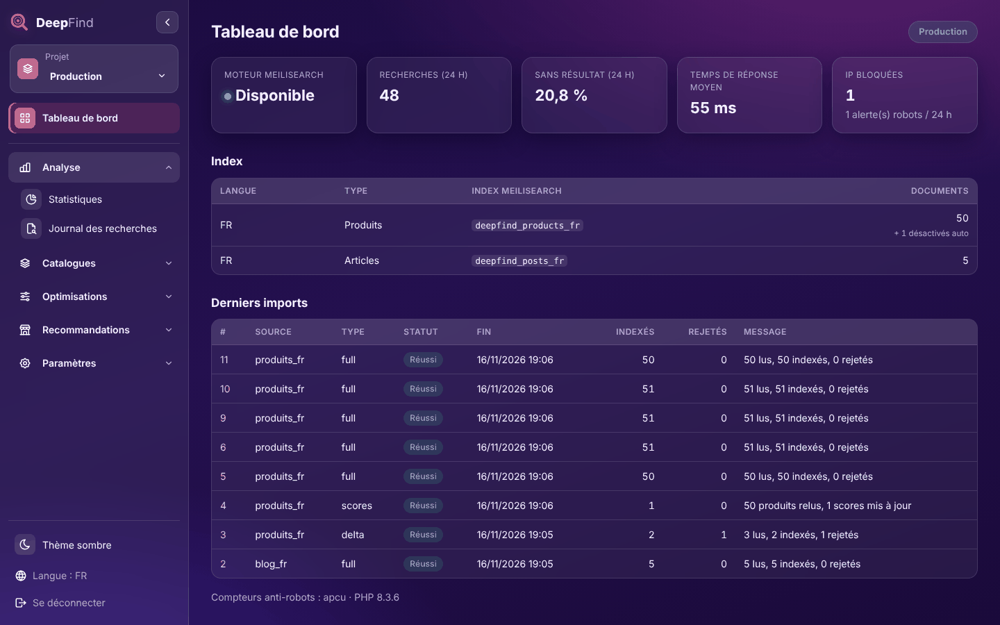

| Widget « sous la barre » | Widget sur mobile | Widget « plein écran » |
|---|---|---|
| 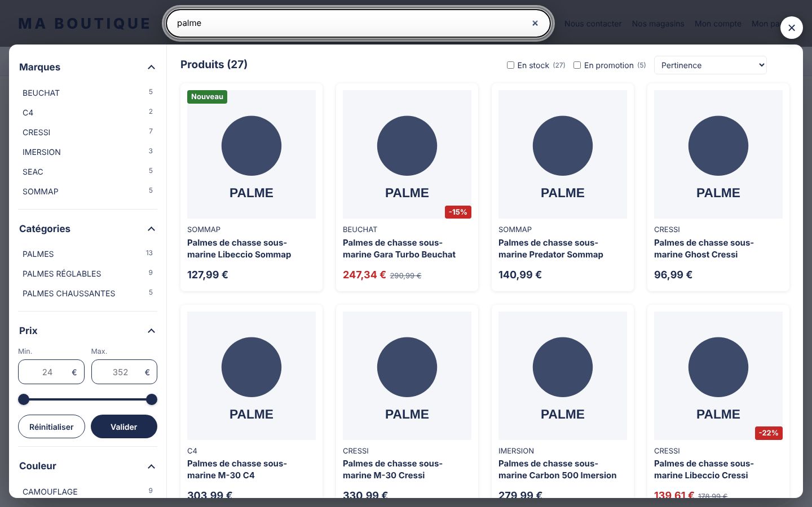 | 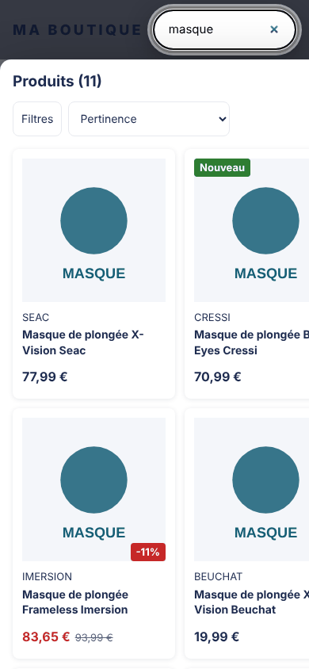 | 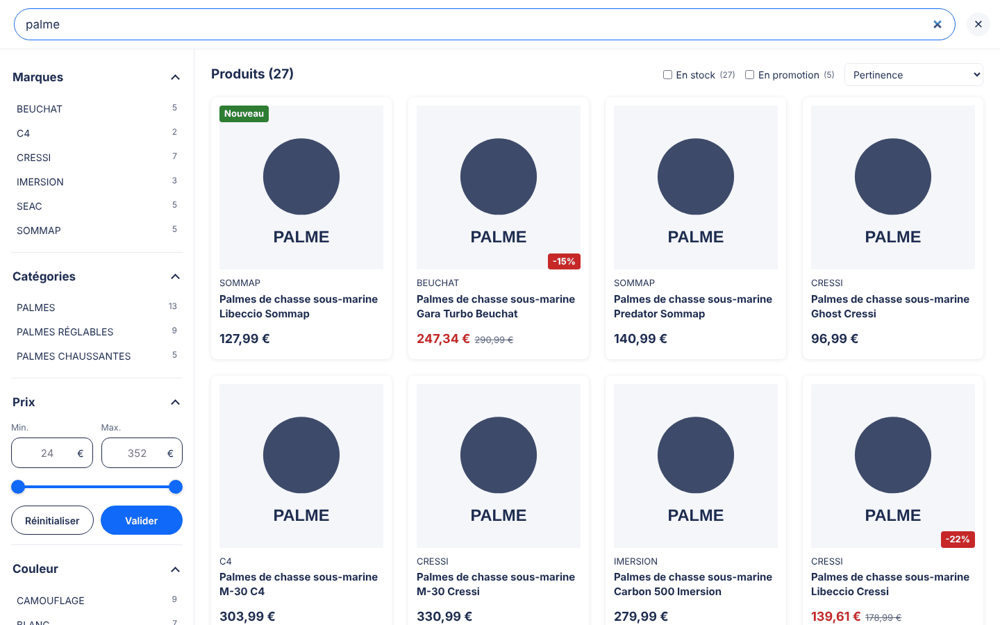 |

> ⚠️ Les flux fournis dans `samples/` sont **fictifs** : produits, prix, stocks et marges sont inventés. Les noms de marques ne servent qu'à illustrer.
> Testez toute installation ou mise à jour sur un serveur de **recette** avant la production.

---

## Sommaire

1. [Comment ça marche](#1-comment-ça-marche)
2. [Logiciels à installer](#2-logiciels-à-installer)
3. [Installation pas à pas](#3-installation-pas-à-pas)
4. [Intégrer le widget sur le site](#4-intégrer-le-widget-sur-le-site)
5. [Formats des flux et mapping](#5-formats-des-flux-et-mapping)
6. [Utiliser l'extranet](#6-utiliser-lextranet)
7. [Personnaliser le widget (Intégration)](#7-personnaliser-le-widget-intégration)
8. [Pertinence et mise en avant](#8-pertinence-et-mise-en-avant)
9. [Anti-robots](#9-anti-robots)
10. [Journaux de recherche et RGPD](#10-journaux-de-recherche-et-rgpd)
11. [Commandes](#11-commandes)
12. [Tests](#12-tests)
13. [Dépannage](#13-dépannage)
14. [Limites connues](#14-limites-connues)

---

## 1. Comment ça marche

```
 Magento 2 ──flux XML produits (complet + delta)──┐
 Blog (Magefan) ──flux XML articles───────────────┤
                                                  ▼
                       bin/console import:run (planificateur / bouton extranet)
                                                  │  lecture en flux, regroupement parents/enfants,
                                                  │  calcul prix « dès », stock, promo, score métier
                                                  ▼
                                          Meilisearch (127.0.0.1:7700, jamais exposé)
                                                  ▲
 Navigateur ─ widget JS (clé publique) ─► /api/v1/search (PHP) ─┘   + MySQL : configuration, règles, journaux
                                           • contrôle clé + domaine
                                           • anti-robots (APCu/Redis)
                                           • règles (résultats personnalisés, boosts, redirections)
                                           • ne renvoie QUE les champs d'affichage (jamais la marge)
```

- **Meilisearch** fait la recherche elle-même (index en mémoire, réponses en quelques millisecondes).
- **PHP / Apache / MySQL** servent l'API, l'extranet, les imports et les journaux.
- **Aucune dépendance Composer** : le code n'utilise que PHP et ses extensions standard.
- Un **import complet** construit un index temporaire, vérifie qu'il n'a pas perdu trop de produits, puis bascule instantanément. Les visiteurs ne voient aucune coupure, et un flux vide ou cassé ne vide jamais la recherche.

## 2. Logiciels à installer

Sur la machine virtuelle. Commandes pour Debian/Ubuntu ; adaptez-les à votre distribution.

| Logiciel | Pourquoi | Obligatoire |
|---|---|---|
| PHP **8.2 minimum** (8.5 visé) en **PHP-FPM** | Application | ✅ |
| Extensions PHP : `pdo_mysql`, `curl`, `xml` (xmlreader, dom, simplexml), `mbstring`, `zlib` | Application | ✅ |
| Extension PHP **`apcu`** | Compteurs anti-robots et cache, en mémoire | Fortement conseillé (sinon Redis ou repli MySQL) |
| OPcache activé | Performances PHP | Fortement conseillé |
| MySQL 8 ou MariaDB 10.6+ | Configuration, règles, journaux | ✅ |
| Apache 2.4 : `proxy_fcgi`, `headers`, `deflate`, `http2`, `ssl` | Serveur web | ✅ |
| **Meilisearch** 1.x (**1.10 minimum**) | Moteur de recherche | ✅ **à installer** |
| Supervisor | Traiter les imports lancés depuis l'extranet | Conseillé (sinon une ligne cron) |
| Redis + `php-redis` | Uniquement si plusieurs serveurs web | Facultatif |

**Mémoire vive pour environ 70 000 produits :** comptez 8 Go sur la machine, dont 4 Go pour Meilisearch. Prévoyez 40 Go de disque SSD.

> PHP 8.5 : sur Debian/Ubuntu, les paquets viennent en général du dépôt d'Ondřej Surý (`packages.sury.org` / PPA `ondrej/php`).
> Vérifiez la disponibilité de `php8.5-apcu` au moment de l'installation. S'il n'existe pas encore, mettez `RATE_STORE=redis` (avec `php8.5-redis`) ou `RATE_STORE=mysql` dans `.env`.
> Le code est testé sous **PHP 8.3** (voir [Tests](#12-tests)). Il n'utilise aucune fonction dépréciée en 8.5 à notre connaissance. Lancez `php bin/console check`, puis la suite de tests, sur votre serveur.

## 3. Installation pas à pas

Toutes les commandes sont à lancer en root (ou avec `sudo`), **sur le serveur de recette d'abord**.

### 3.1 PHP et extensions

```bash
apt install php8.5-fpm php8.5-cli php8.5-mysql php8.5-curl php8.5-xml php8.5-mbstring php8.5-apcu supervisor
```

Dans `/etc/php/8.5/fpm/conf.d/` (fichier `99-deepfind.ini`), ajoutez :

```ini
opcache.enable=1
opcache.memory_consumption=128
opcache.validate_timestamps=1
apc.enabled=1
apc.shm_size=64M
memory_limit=512M
```

### 3.2 Meilisearch

1. Téléchargez le binaire Linux de la **dernière version stable 1.x** depuis <https://github.com/meilisearch/meilisearch/releases>. Notez le numéro de version pour pouvoir le reproduire.
2. Installez-le :

```bash
install -m 755 meilisearch-linux-amd64 /usr/local/bin/meilisearch
```

```bash
useradd --system --home /var/lib/meilisearch --shell /usr/sbin/nologin meilisearch
```

```bash
mkdir -p /var/lib/meilisearch && chown meilisearch: /var/lib/meilisearch
```

3. Créez `/etc/meilisearch.env` avec `MEILI_MASTER_KEY=…`. Utilisez une valeur longue et aléatoire (`openssl rand -hex 32`), puis :

```bash
chmod 600 /etc/meilisearch.env && chown meilisearch: /etc/meilisearch.env
```

4. Copiez `deploy/meilisearch.service` dans `/etc/systemd/system/`, puis :

```bash
systemctl daemon-reload && systemctl enable --now meilisearch
```

5. Vérifiez : `curl http://127.0.0.1:7700/health` doit répondre `{"status":"available"}`.

> Meilisearch n'écoute que sur `127.0.0.1` : il n'est **jamais** accessible depuis Internet. Ne le changez pas.

### 3.3 Base de données

```sql
CREATE DATABASE deepfind CHARACTER SET utf8mb4 COLLATE utf8mb4_unicode_ci;
CREATE USER 'deepfind'@'localhost' IDENTIFIED BY 'MOT_DE_PASSE_FORT';
GRANT ALL ON deepfind.* TO 'deepfind'@'localhost';
```

### 3.4 Application

```bash
git clone <URL_DU_DEPOT> /var/www/deepfind
```

```bash
cd /var/www/deepfind && cp .env.example .env && chmod 640 .env
```

```bash
php bin/console admin:token
```

Copiez les valeurs `ADMIN_TOKEN` et `APP_SECRET` affichées dans `.env`, puis complétez `DB_*`, `MEILI_MASTER_KEY` (la même qu'à l'étape 3.2) et `APP_URL` (adresse publique de DeepFind, par exemple `https://search.example.com`).

```bash
chown -R www-data: var && chgrp www-data .env
```

```bash
php bin/console check
```

```bash
php bin/console install
```

`install` crée ou met à jour les tables. Vous pouvez la relancer sans risque après chaque mise à jour du code : elle ajoute ce qui manque sans rien effacer.

### 3.5 Apache

Copiez `deploy/apache-vhost.conf` dans `/etc/apache2/sites-available/deepfind.conf`, puis adaptez le nom de domaine et les certificats. Ensuite :

```bash
a2enmod proxy_fcgi setenvif headers deflate http2 ssl && a2enconf php8.5-fpm
```

```bash
a2ensite deepfind && apachectl configtest && systemctl reload apache2
```

Conseillé : limitez `/admin` aux adresses IP de vos bureaux ou de votre VPN (bloc commenté dans le fichier).

### 3.6 Worker et tâches planifiées

```bash
cp deploy/supervisor-worker.conf /etc/supervisor/conf.d/deepfind-worker.conf && supervisorctl reread && supervisorctl update
```

Ajoutez ensuite les lignes de `deploy/crontab` dans la crontab de `www-data` (`crontab -u www-data -e`). Une seule ligne suffit pour les imports : le **planificateur** `schedule:run`, lancé chaque minute. Les horaires de chaque flux se règlent ensuite dans l'extranet (voir 3.7). Sans Supervisor, utilisez la variante `schedule:run --work`, indiquée dans le fichier.

### 3.7 Premier import

1. Connectez-vous à `https://search.example.com/admin` (votre `APP_URL` suivi de `/admin`) avec le jeton `ADMIN_TOKEN`.
2. **Catalogues › Flux & mapping** : remplacez l'URL d'exemple de `produits_fr` par l'URL de votre flux Magento, puis faites de même pour `blog_fr`. Si le flux est protégé par mot de passe (.htaccess), renseignez l'utilisateur et le mot de passe dans **Accès au flux**, puis cliquez sur **Tester la connexion**.
3. **Mapping** (mapping visuel) : DeepFind analyse le flux. Pour chaque champ (obligatoires en premier), choisissez à droite le champ du flux correspondant, puis enregistrez. Voir la section 5.
4. **Tester** : vérifiez que le mapping produit le bon document, sans rien indexer.
5. **Planification des imports** (dans la fiche du flux) : choisissez par exemple « Chaque nuit à 3 h 15 » pour l'import complet et « Toutes les 15 min de 6 h à 23 h » pour le delta.
6. **Import complet** pour un premier chargement immédiat, puis suivez l'avancement dans **Catalogues › Imports**.
7. **Paramètres › Clés** : créez une clé pour le domaine de votre site (ex. `example.com`), puis testez avec **Recommandations › Démo du widget**.
8. **Paramètres › Intégration** : copiez le code à ajouter sur le site (section 4) et réglez l'affichage (section 7).

## 4. Intégrer le widget sur le site

Le code exact (avec votre clé et le bon numéro de version) est donné dans **Paramètres › Intégration › Layers › Code à ajouter sur le site**. Sur Magento, ajoutez-le avant `</body>`, par exemple dans *Contenu › Design › Configuration › HTML Head › Scripts et feuilles de style* ou dans un bloc du thème :

```html
<script src="https://search.example.com/widget/deepfind.js?v=24" defer
  data-key="pk_VOTRE_CLE_PUBLIQUE"
  data-lang="fr"
  data-input="#search"
  data-results-url="https://www.example.com/fr/catalogsearch/result/?q="></script>
```

**Fonctionnement**
- **Activation** : au chargement, le widget demande à l'API (`/api/v1/config`) si le projet de la clé est actif, et récupère l'affichage choisi dans l'extranet (layer actif, filtres, tris). Il ne prend la main que si le projet est actif. **Projet désactivé** ou **API injoignable** : rien n'est modifié, la recherche d'origine du site fonctionne normalement. La réponse est gardée 1 min par le navigateur et 5 min dans la session du visiteur : un changement dans l'extranet arrive sur le site en 5 minutes au plus.
- **Affichage** : selon le layer actif (section 7) : sous la barre de recherche (par défaut), plein écran, flottant ou intégré dans un bloc de la page.
- **Touche Entrée** : ouvre la page de résultats du site, ou, si ce réglage est désactivé (Paramètres › Paramètres › Widget sur le site), laisse seulement la fenêtre DeepFind. `data-enter="off"` / `"on"` force le comportement sur une page.
- **Autocomplétion d'origine du site** (panneau Magento « Suggestions de recherche », Amasty, Mirasvit, Smile ElasticSuite…) : bloquée par défaut, pour que deux fenêtres ne s'ouvrent pas en même temps. Le réglage « Bloquer l'autocomplétion d'origine » (Paramètres › Paramètres › Widget sur le site) la réactive. Sur le script, `data-native="keep"` (laisser) ou `data-native="block"` (bloquer) est prioritaire sur ce réglage. Si un autre panneau apparaît encore, ajoutez son sélecteur : `data-hide=".mon-panneau"`.
- **Fonctions** : attente de 180 ms après la frappe, annulation des requêtes dépassées, cache local, chargement au défilement, filtres (marques, catégories, attributs, prix avec curseur, en stock, en promotion), blocs de filtres repliables, tris, articles de blog, redirections, bannières, touche Échap, version mobile avec bouton « Filtres ».
- **Clics** : chaque ouverture d'un produit, d'un article ou d'une bannière depuis la fenêtre (clic, Ctrl/Cmd + clic, clic molette) est mesurée (`sendBeacon`), sans cookie, avec un identifiant aléatoire créé à chaque chargement de page. Les clics des 30 derniers jours entrent dans le score métier.
- **Mesure d'audience** : sur les pages choisies dans **Analyse › Audience**, le widget envoie un signal « page vue » anonyme (`/api/v1/visit`), sans cookie ni donnée personnelle (section 6, « Audience »).
- **Multilingue** : `data-lang="en"` et une clé autorisée pour `en`. Chaque langue a son propre index et sa propre source de flux.

**Attributs du script**

| Attribut | Rôle |
|---|---|
| `data-key` | Clé publique (obligatoire) |
| `data-lang` | Langue des résultats (`fr` par défaut) |
| `data-input` | Sélecteur CSS du ou des champs de recherche du site (si le layer actif n'en indique pas) |
| `data-results-url` | Page « Tout voir » (la recherche est ajoutée à la fin). Vide = bouton masqué |
| `data-gap` | Layer « Sous la barre » : écart en pixels entre la barre de recherche et la fenêtre (12 par défaut) |
| `data-position="anchor"` + `data-anchor` | Layer « Sous la barre » : ouvrir plutôt la fenêtre sous un élément du site (ex. `header.page-header`) |
| `data-enter` | `off` / `on` : comportement de la touche Entrée (sinon : réglage de l'extranet) |
| `data-native` | `keep` / `block` : autocomplétion d'origine du site (sinon : réglage de l'extranet) |
| `data-hide` | Sélecteurs CSS supplémentaires de panneaux d'origine à masquer |
| `data-currency`, `data-locale` | Format des prix (`EUR`, `fr-FR` par défaut) |
| `data-min-chars`, `data-page-size` | Caractères avant recherche, produits chargés à la fois (sinon : réglages du layer) |

> Après une mise à jour du widget, changez le numéro `?v=` (ex. `?v=23` en `?v=24`) pour forcer le rechargement par les navigateurs. Le numéro à jour est toujours celui du code donné dans **Intégration**.

## 5. Formats des flux et mapping

Deux options pour les flux :

- **Le format DeepFind (recommandé)** : le mapping par défaut fonctionne sans modification. Exemples complets : `samples/products_fr.xml`, `samples/products_fr_delta.xml`, `samples/blog_fr.xml`.
- **Votre propre format** : vous adaptez le mapping de la source (mapping visuel ou JSON). Exemple : `samples/mapping_flat_example.json` pour `samples/products_fr_flat.xml`.

**Règles communes :**
- Encodage UTF-8.
- Textes entre `<![CDATA[ ]]>`.
- Prix avec un point ou une virgule (les deux sont acceptés).
- Dates au format ISO 8601.
- Fichier `.xml` ou `.xml.gz`.
- Flux lu au fil de l'eau : taille illimitée.

### Produits : champs internes

| Champ | Type | Obligatoire | Usage |
|---|---|---|---|
| `id` | texte | conseillé | identifiant (entity_id) |
| `sku` | texte | ✅ | recherche exacte prioritaire |
| `type` | simple/configurable… | | info |
| `parent_id` | texte | flux à plat | rattachement d'un enfant à son parent |
| `enabled` | 0/1 | | 0 = produit non vendable (voir « Produits désactivés ») |
| `name` | texte | ✅ | recherche (poids fort), affichage |
| `brand` | texte | conseillé | filtre « Marques » |
| `url`, `image`, `image_hover` | URL http(s) | url ✅ | affichage (utilisez l'image *cache* redimensionnée de Magento) |
| `short_description`, `description` | texte/HTML | | recherche (poids faible), le HTML est retiré |
| `ean` | texte | | recherche exacte |
| `child_skus` | liste | | SKU des enfants listés dans le parent (`SU-1,SU-2`, séparés par virgule, point-virgule ou `\|`) : chercher l'un d'eux affiche le parent (voir ci-dessous) |
| `price` | décimal | ✅ (ou final_price) | prix barré si promo |
| `final_price` | décimal | conseillé | prix affiché (exportez le **prix final** Magento, règles de prix catalogue incluses) |
| `in_stock`, `salable_qty` | oui/non, entier | conseillé | exportez la **quantité vendable MSI**. Pour `in_stock`, sont reconnus comme « en stock » : 1, un nombre > 0, oui/yes/true, « En stock », `in_stock`, `available`, `preorder`, `backorder` (Google Shopping) et `https://schema.org/InStock`. Tout le reste = rupture |
| `margin_rate` | 0 à 1 | | **classement uniquement, jamais envoyé au site** |
| `sales_30d` | entier | | popularité |
| `created_at` | date | | badge « Nouveau » et classement |
| `rating`, `reviews_count` | | | affichage |
| `search_keywords` | texte | | mots-clés en plus |
| `manual_boost` | -10 à +10 | | boost éditorial permanent |

**Blocs particuliers :**
- `categories` : une ou plusieurs catégories, avec leur chemin « A > B > C ».
- `attributes` : attributs génériques (code, libellé, `filterable="1"`). Les attributs filtrables peuvent devenir des filtres du widget (section 7).
- `variants` : les enfants, avec les champs `id, sku, ean, url, image, price, final_price, in_stock, salable_qty`, plus leurs propres attributs (taille…).

### Parents et enfants Magento

- **`"variant_mode": "nested"`** (recommandé) : les enfants sont dans `<variants>` sous le parent.
- **`"variant_mode": "flat"`** : chaque produit est sur sa propre ligne et les enfants ont un `parent_id`. Le regroupement se fait pendant l'import, dans une table de travail MySQL. L'ordre des lignes n'a pas d'importance. Mettez `"parent_match": "sku"` si `parent_id` contient le SKU du parent.

- **Liste des enfants dans le parent** (flux de type Google Shopping, ex. `<skus_enfants>SU-1,SU-2</skus_enfants>`, sans ligne propre pour chaque enfant) : mappez ce champ sur **SKU des enfants** (proposé automatiquement). Chercher un de ces SKU affiche le parent ; son prix est présenté « dès » (le flux ne donne ni prix ni stock par enfant). Restez en mode imbriqué.

**Résultat dans tous les cas :**
- Un seul document par parent.
- Prix « dès » = celui de l'enfant en stock le moins cher.
- Le parent est « en stock » si au moins un enfant l'est.
- Les SKU et EAN des enfants sont recherchables : chercher le SKU d'un enfant affiche le parent avec la variante.
- Les attributs des enfants (taille…) deviennent des filtres du parent.

### Flux delta (stock, prix, suppressions)

Même structure que le flux complet, avec seulement le `sku` et les champs modifiés, plus un bloc `<deleted><sku>…</sku></deleted>`.

- Un SKU d'enfant met à jour l'enfant et recalcule le parent.
- Un SKU inconnu est signalé dans le rapport d'import et sera créé au prochain import complet.
- Les catégories et attributs ne changent qu'à l'import complet.

### Blog (Magefan)

Champs : `id`, `title`, `url`, `published_at` (obligatoires), plus `image`, `excerpt`, `content`, `author`, `updated_at`, `categories/category`, `tags/tag`, `related_products/sku`, `enabled`. Seul l'import complet est disponible (le volume est faible).

### Mapping visuel (recommandé)


**Catalogues › Flux & mapping › Mapping** : DeepFind télécharge le flux (ou réutilise le téléchargement de moins d'une heure), détaille ses 300 premiers éléments (exemples de valeurs, groupes répétés) puis parcourt **tout le fichier** pour lister **toutes les balises**, même celles qui n'apparaissent que plus loin, ou qui sont absentes quand elles sont vides. Le taux de présence est calculé sur tout le flux ; une balise toujours vide est signalée « (toujours vide) » et n'est jamais pré-sélectionnée. Parcours limité à 60 secondes (environ 1,5 s pour 40 Mo), résultat gardé en cache tant que le fichier ne change pas.

**Ce qui est détecté :**
- L'élément qui représente un produit (`<product>`, `<item>`…), modifiable.
- Le mode des variantes : imbriqué, ou « à plat » si un champ parent est trouvé et qu'il n'y a pas de groupe répété.
- Le groupe des variantes (ex. `variants/variant`).
- **Tous les champs** : éléments, attributs XML (`@id`), et attributs identifiés par un code (`attributes/attribute[@code='couleur']`).

**Présentation de l'écran :**
- **À gauche**, les champs DeepFind : d'abord les **obligatoires** (marqués d'un `*`, surlignés tant qu'ils ne sont pas mappés), puis les **secondaires**.
- **À droite**, une liste déroulante des champs détectés, avec un **exemple de valeur** et le **taux de présence** (ex. `url_key (22 %)` : présent seulement sur les parents d'un flux à plat).
- Les champs sont **pré-sélectionnés automatiquement** d'après les noms usuels (badge « auto ») : `url_key` pour l'URL, `special_price` pour le prix final, `manufacturer` pour la marque, `is_in_stock`, `qty`… Vérifiez toujours ces suggestions.
- Choisir **« — non mappé — »** pour un champ est mémorisé : il n'est plus re-proposé automatiquement.
- Pour les champs oui/non (stock, activé), l'écran montre comment chaque valeur d'exemple sera comprise (`in_stock = oui, out_of_stock = non`).
- Une colonne facultative permet d'ajouter des **transformations** (ex. `to_float, divide:100` pour une marge en %).
- **Sections suivantes** : variantes, catégories (chemin et identifiant), **attributs filtrables** (liste « par code » détectée, ou champs simples comme `color` et `size`, proposés automatiquement).

Le résultat est enregistré dans le mapping JSON de la source, qui reste modifiable en **mode avancé**.

### Syntaxe du mapping (JSON, mode avancé)

```json
"fields": {
  "brand":       {"path": "manufacturer", "transform": ["trim", "uppercase"]},
  "final_price": {"path": "special_price", "transform": ["default:0"]},
  "margin_rate": {"path": "marge_pct", "transform": ["to_float", "divide:100"]},
  "id":          {"path": "@id"},
  "type":        {"value": "simple"}
}
```

- **Chemins** :
  - `nom` : élément enfant ;
  - `a/b` : sous-élément ;
  - `@attr` : attribut ;
  - `a/@attr` : attribut d'un enfant ;
  - `.` : texte de l'élément ;
  - toute autre expression est lue comme du XPath (`g:price`, `attribute[@code='color']`).
- **Transformations** : `trim`, `lowercase`, `uppercase`, `ucfirst`, `strip_html`, `to_float`, `to_int`, `to_bool` (accepte 1/0, oui/non, « En stock »…), `divide:N`, `multiply:N`, `default:X`, `split:SEP`, `prefix:X`, `suffix:X`, `replace:A|B`, `truncate:N`, `date_iso`.
- **Attributs simples** d'un flux à plat : `"extra_attributes": {"couleur": {"path": "color", "label": "Couleur", "filterable": true}}`.

> 🔒 Le flux produits contient la marge : protégez son URL côté Magento (mot de passe .htaccess / .htpasswd, jeton, filtrage IP, HTTPS).

**Accès au flux** (fiche de la source, Catalogues › Flux & mapping) :
- **Utilisateur et mot de passe** d'un flux protégé par le serveur web (.htaccess / .htpasswd, authentification Basic ou Digest). Le mot de passe est **chiffré** dans la base (clé dérivée de `APP_SECRET`), n'est jamais réaffiché (laisser le champ vide le conserve, une case permet de le supprimer) et n'est envoyé qu'au serveur du flux, jamais à un autre site en cas de redirection. Si `APP_SECRET` change, ressaisissez-le.
- **En-têtes HTTP supplémentaires** (jeton…), un par ligne.
- **Tester la connexion** : vérifie le flux complet et le flux delta avec les valeurs saisies, sans enregistrer ni télécharger tout le fichier (premiers Ko seulement). Résultat : code HTTP (200 = fichier trouvé ; 401 = protégé, ou identifiants refusés ; 403 = accès refusé ; 404 = adresse introuvable ; serveur injoignable), protection détectée ou non, taille, date de modification, redirection, et nature du contenu (XML, fichier .gz, ou page HTML par erreur). Fonctionne aussi pour un flux sans protection et pour un chemin local.
- Le téléchargement JSON de la configuration (Projets) ne contient ni mot de passe ni en-têtes d'accès ; la copie entre projets les reprend avec les adresses des flux.

## 6. Utiliser l'extranet

L'extranet s'utilise depuis `/admin`, avec le jeton `ADMIN_TOKEN`. La connexion est mémorisée pendant 10 jours. Le bouton « Se déconnecter » révoque le cookie de ce navigateur. Il n'y a pas de comptes utilisateurs. Le menu de gauche se replie, et le bouton en bas du menu bascule entre les thèmes sombre et clair ; ces deux choix sont mémorisés.

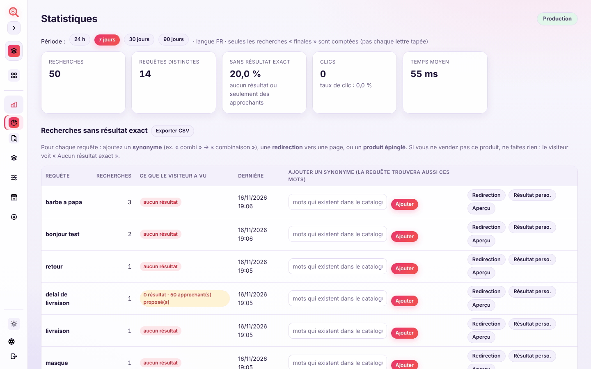

### Menu

| Rubrique | Page | À quoi ça sert |
|---|---|---|
| | Tableau de bord | État du moteur, recherches et taux sans résultat sur 24 h, nombre de produits (et de produits désactivés auto), derniers imports, alertes de configuration |
| **Analyse** | Audience | Statistiques quotidiennes **anonymes** : visiteurs, part qui cherche, recherches par visiteur, clics, mobile / tablette / ordinateur, évolution jour par jour, export CSV (voir « Audience » ci-dessous) |
| | Statistiques | Top requêtes, **recherches sans résultat exact** (aucun résultat ou seulement des approchants) avec ajout direct d'un **synonyme**, d'une redirection ou d'un résultat personnalisé, **produits les plus cliqués** (clics, requêtes d'origine, position moyenne), requêtes avec résultats mais sans clic, export CSV |
| | Journal des recherches | Détail filtrable et exportable |
| **Catalogues** | Flux & mapping | Sources (URL complet/delta, authentification), **mapping visuel**, mapping JSON avancé, **test du mapping sans indexer**, **planification des imports**, imports manuels |
| | Imports | Historique (durée, **écart avec l'import précédent**), rapports (motifs de rejet, exemples de SKU rejetés), suivi en direct |
| | Produits désactivés | Produits retirés des recherches avec le bouton « Désactiver » de l'aperçu interne, avec filtre, « Activer » et « Tout réactiver » |
| | Robots & blocages | IP les plus actives, requêtes répétées, alertes, blocage et déblocage |
| **Optimisations** | Pertinence & classement | Correspondance des mots, importance des champs, score métier (section 8) |
| | Règles de boost | Coefficients appliqués aux produits qui remplissent des conditions (section 8) |
| | Synonymes & alias | Une ligne = des mots qui donnent les mêmes résultats, séparés par des virgules (ex. `ecoflow, ecoflau, ecauflo`) ; option « sens unique » (le 1er mot mène aux suivants) ; recherche et modification dans le tableau ; import CSV (`samples/synonymes.csv`) |
| | Redirections | Envoyer certaines recherches vers une page (section 8) |
| **Recommandations** | Résultats personnalisés | Produits affichés en premier, seuls ou exclus pour certaines recherches (section 8) |
| | Règles | Résultats selon la **page du site** (adresse), sans mot-clé : uniquement certains produits, filtre pré-coché retirable, ou exclusion (section 8) |
| | Bannières | Image ou code HTML en haut des résultats (section 8) |
| | Aperçu interne | Résultats avec **marge, score métier, ventes, règles appliquées**, boost rapide, épinglage, désactivation |
| | Démo du widget | Le widget sur une page de démonstration, avec le **layer de votre choix** |
| **Paramètres** | Projets | Production, Test… (voir plus bas) |
| | Clés | Clés publiques et domaines autorisés |
| | Intégration | Layers, filtres, options de tri, code du site, favori de test (section 7) |
| | Cache | État et purge des caches |
| | Paramètres | Seuils anti-robots, recherche, widget sur le site, journaux, sécurité des imports |

### Aperçu interne

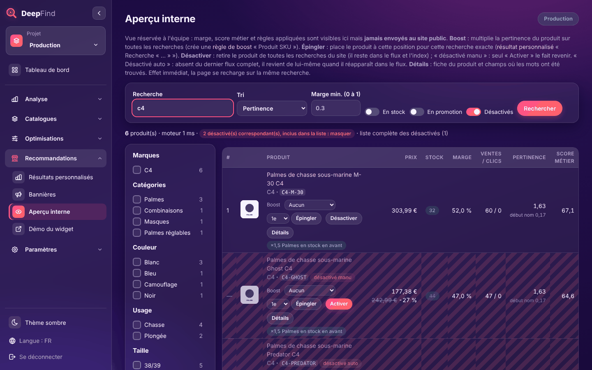

Réservé à l'équipe : la marge, le score métier et les règles appliquées n'y sont visibles que dans l'extranet, **jamais envoyés au site public**.
- Tri par rentabilité, filtre « marge minimum », filtres du catalogue cliquables.
- Sur chaque produit : **boost rapide** (crée une règle de boost « Produit SKU »), **épingler** à une position pour la recherche en cours, **désactiver** (retire le produit de toutes les recherches), **détails** (fiche du produit et champs où les mots ont été trouvés).
- L'interrupteur **« Désactivés »** affiche aussi les produits désactivés qui correspondraient à la recherche, avec leur type :
  - **« désactivé manu »** : désactivé avec le bouton « Désactiver ». Seul « Activer » le fait revenir, même s'il est dans le flux.
  - **« désactivé auto »** : absent du dernier flux complet (voir ci-dessous). Il revient de lui-même quand il réapparaît dans le flux.

### Produits absents du flux : désactivation automatique

À chaque **import complet**, DeepFind compare le flux avec l'index en ligne, par SKU :
- un produit **absent du flux** (ou rejeté, par exemple `enabled = 0` ou prix nul) devient **non vendable** : il est gardé **90 jours** dans l'index, sans jamais être proposé aux visiteurs, puis retiré ;
- s'il **revient dans le flux complet**, il est **réactivé automatiquement** ;
- une **désactivation manuelle** reste indépendante du flux.

Le contrôle de sécurité de l'import (« Import bloqué si le catalogue baisse de plus de N % », 20 % par défaut) porte sur les produits vendables. Le tableau de bord compte les produits désactivés auto à part.

> Après une mise à jour qui apporte cette fonction, lancez un **import complet** : le filtre « vendable » ne s'active qu'une fois l'index reconstruit.

### Imports

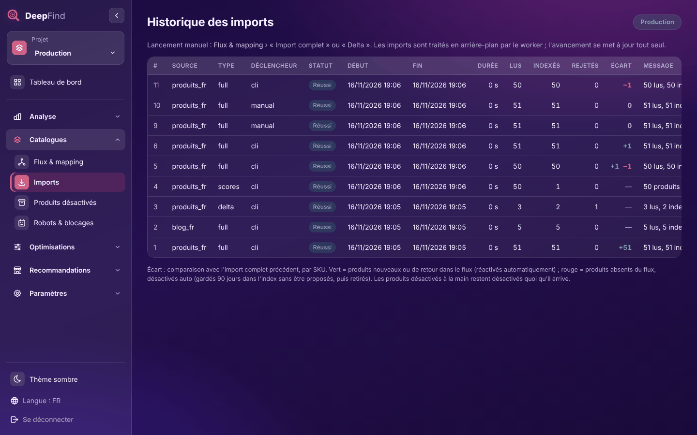

**Depuis l'extranet :** **Catalogues › Flux & mapping** › bouton **« Import complet »** (ou **« Delta »**) sur la ligne du flux.
- L'import est mis en file d'attente puis traité **en arrière-plan** par le worker (Supervisor), ou par la tâche cron `schedule:run --work` sans Supervisor. Vous arrivez directement sur sa **page de suivi**, qui se met à jour toute seule toutes les 2 secondes. Vous pouvez la quitter : l'import continue.
- **Étapes affichées** : téléchargement (Mo reçus / Mo total), comptage des éléments du flux, lecture, regroupement parents/enfants (flux à plat), indexation dans Meilisearch, bascule. Avec le pourcentage global, le temps écoulé et le **temps restant estimé**.
- **Historique** : début, fin, **durée**, éléments lus, indexés, rejetés, et **écart** avec l'import complet précédent : en vert les produits nouveaux ou revenus dans le flux, en rouge les produits désactivés auto (détail au survol).
- **Résultats immédiats** : dès la bascule, la recherche renvoie les nouveaux résultats. Tous les caches sont invalidés automatiquement.

**En ligne de commande** (affiche la progression par tranche de 10 %) :

```bash
php bin/console import:run --source=produits_fr
```

**Flux volumineux :** le fichier est téléchargé sur disque, puis lu au fil de l'eau. La mémoire reste constante quelle que soit sa taille.
- Mesure en test (environ 15 000 produits avec variantes) : **20 Mo de mémoire** pour un flux de **40 Mo**, comptage préalable en moins d'une seconde.
- La durée totale dépend surtout de l'indexation par Meilisearch, à mesurer sur votre serveur. L'import complet relit aussi l'index en ligne pour calculer l'écart.

### Planification des imports

Dans la fiche de chaque flux (**Flux & mapping › nom du flux**), section « Planification des imports » :
- choisissez un préréglage (« Chaque nuit à 3 h 15 », « Toutes les 15 min de 6 h à 23 h »…) ou saisissez une expression cron standard (`minute heure jour mois jour-semaine`, ex. `30 2 * * 1-6`) ;
- les **3 prochaines exécutions** s'affichent après l'enregistrement, et la liste des flux montre la prochaine ;
- les horaires sont ceux du serveur (`APP_TIMEZONE`, Europe/Paris par défaut) ;
- un import n'est lancé que si la source est **active** et si l'import précédent de cette source est terminé (sinon le créneau est sauté) ;
- l'import delta planifié n'a lieu que si une URL de flux delta est renseignée ;
- le tableau de bord signale un planificateur arrêté (aucun passage depuis 5 minutes alors que des imports sont planifiés).

### Projets : Production et Test

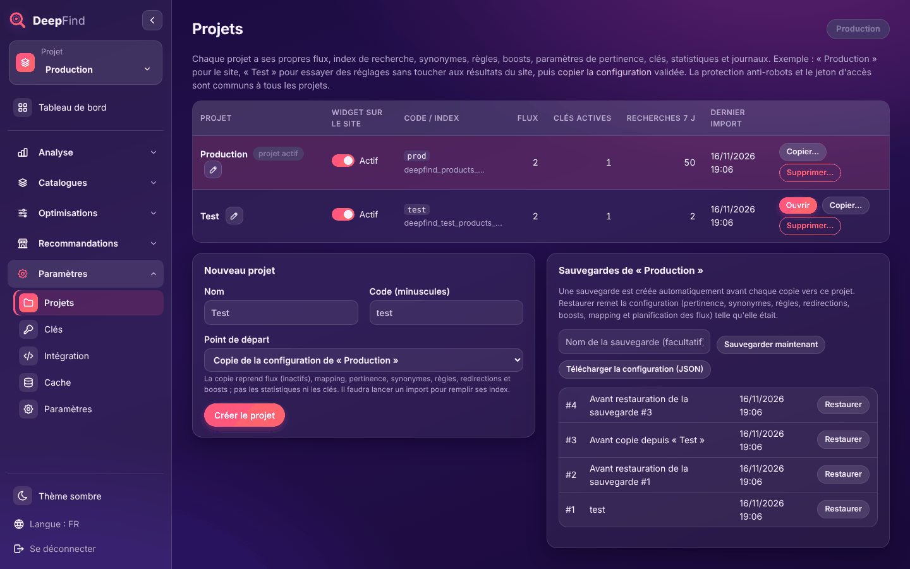

Le **sélecteur en haut du menu** choisit le projet actif. Un badge en haut à droite de chaque page rappelle sur quel projet vous travaillez : vert pour le premier projet, orange pour les autres.

**Dans la liste des projets** : le crayon renomme un projet ; l'interrupteur **« Widget sur le site »** active ou désactive le widget des sites qui utilisent les clés du projet (après confirmation). Désactivé, le widget ne prend plus la main et la recherche d'origine du site reprend.

**Ce que chaque projet a en propre** :
- les flux, le mapping, la planification et les imports ;
- les **index de recherche** : `deepfind_products_fr` pour le premier projet, `deepfind_test_products_fr` pour un projet de code `test` ;
- les synonymes, règles, redirections, boosts, résultats personnalisés et bannières ;
- la pertinence, les paramètres, les layers, filtres et tris ;
- les clés publiques et la démo du widget ;
- les statistiques, journaux, clics et le cache.

**Commun à tous les projets** : la protection anti-robots (seuils, IP bloquées), la durée de conservation des journaux et le jeton d'accès.

**Mettre en place un projet de test** :
1. Dans **Projets › Nouveau projet**, saisissez par exemple « Test », code `test`, avec comme point de départ « Copie de la configuration de Production ».
2. Ouvrez **Flux & mapping** dans ce projet, puis lancez un **import complet**. Ses flux sont créés inactifs, donc sans import planifié tant que vous ne les activez pas.
3. Réglez la pertinence, les synonymes, etc. dans Test. Vérifiez le résultat avec l'**aperçu interne** ou la **démo du widget**, qui utilise la clé du projet Test.

**Copier une configuration validée vers Production** : **Projets › Copier sa configuration…**
1. Choisissez le projet source et le projet cible, puis les éléments à copier : pertinence, paramètres de recherche, synonymes, règles, redirections, règles de boost, mapping et planification des flux. Les URL des flux ne sont copiées que si vous l'activez.
2. **« Voir ce qui va changer »** affiche le résumé des différences.
3. **« Confirmer »** applique la copie. Une **sauvegarde de la cible** est faite juste avant, et les réglages sont envoyés aux index de la cible tout de suite.
4. Lancez ensuite un recalcul des scores ou un import si des poids, boosts ou mappings ont changé.

**Ce qui n'est jamais copié** : statistiques, journaux, clics, historique des imports, clés publiques, produits indexés. Les layers, filtres et tris ne font pas encore partie de la copie.

**Sauvegardes** (**Projets**, partie droite) : une sauvegarde est créée automatiquement avant chaque copie, et vous pouvez en créer une à la main. **« Restaurer »** remet la configuration telle qu'elle était (après avoir sauvegardé l'état actuel). **« Télécharger la configuration (JSON) »** permet de l'archiver.

**Charge sur le serveur** : un projet de test qui indexe tout le catalogue double à peu près la mémoire utilisée par Meilisearch, et ses imports consomment du processeur sur la même machine. Planifiez-les hors des heures de pointe, ou gardez dans Test un flux réduit.

> Les projets servent à tester des **réglages**. Une **nouvelle version de DeepFind** (le code) se teste toujours sur une installation de recette séparée.

En ligne de commande, l'option `--project=CODE` cible un projet, par exemple :

```bash
php bin/console import:run --project=test --source=produits_fr
```

### Clés

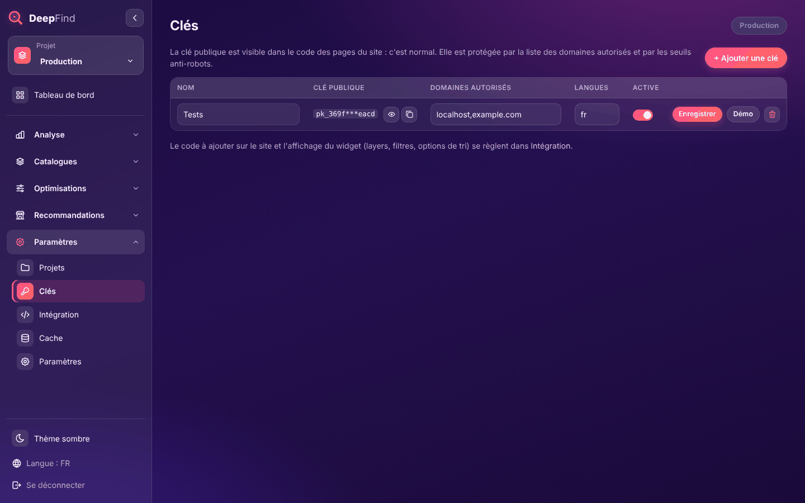

- **« + Ajouter une clé »** ouvre une fenêtre : nom, domaines autorisés (séparés par des virgules, sous-domaines inclus), langues.
- Une ligne par clé : nom, clé publique **masquée** (début et fin visibles), domaines, langues, active. L'**œil** affiche la clé complète, le bouton **copier** la met dans le presse-papiers.
- La clé publique est visible dans le code des pages du site : c'est normal. Elle est protégée par la liste des domaines autorisés et par les seuils anti-robots.

### Paramètres

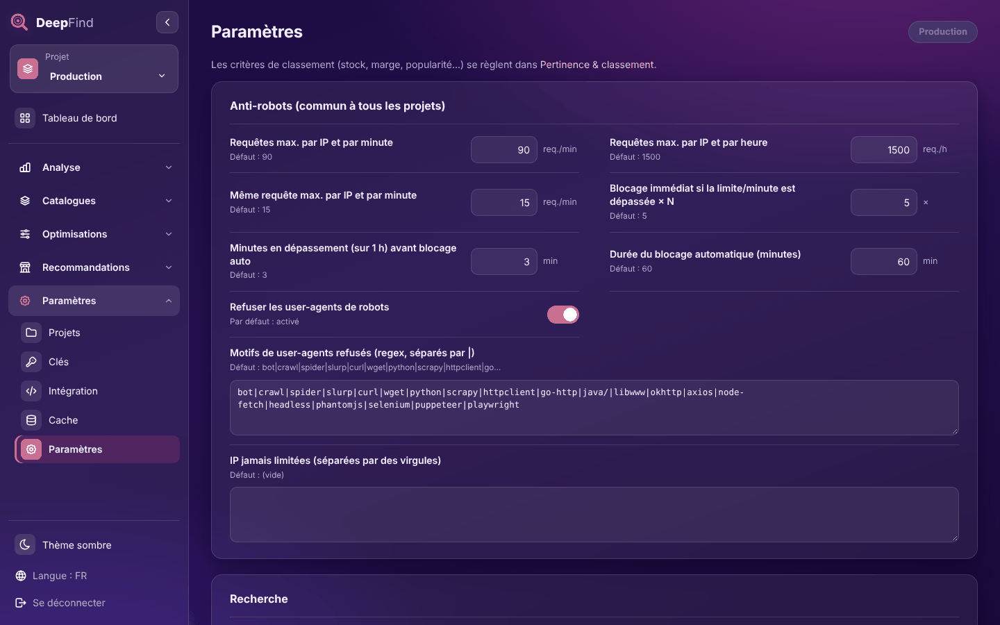

Un bloc par thème, une ligne par réglage (valeur par défaut rappelée) :
- **Anti-robots** (commun à tous les projets) : seuils par IP, blocage automatique, user-agents refusés, IP jamais limitées (section 9).
- **Recherche** : articles de blog affichés, produits max. par page, cache des réponses, valeurs max. par filtre.
- **Widget sur le site** : comportement de la touche Entrée, blocage de l'autocomplétion d'origine du site, changement de photo au survol d'un produit (deuxième image, activé par défaut).
- **Journaux & import** : journalisation des recherches, conservation des journaux, seuil de sécurité des imports complets.

### Audience

**Analyse › Audience** suit l'évolution, jour après jour, de l'usage du site et du moteur de recherche, sans aucune information personnelle :
- **Visiteurs par jour**, **part des visiteurs qui cherchent** (les autres naviguent sans chercher), **recherches par visiteur** (1, 2 ou 3, 4 et plus), **part qui clique sur un résultat**, **pages vues par visiteur**.
- Répartition **mobile / tablette / ordinateur** (d'après la taille de l'écran indiquée par le widget, sinon le navigateur).
- Courbe quotidienne (journées complètes ; survol ou flèches du clavier pour le détail), tableau jour par jour, export CSV ; périodes 7 jours, 30 jours, 90 jours, 12 mois, ou **Personnalisé** (dates de début et de fin, 2 ans au plus).

**Comment c'est mesuré**
- Le widget envoie un petit signal « page vue » (`POST /api/v1/visit`) sur les pages choisies. Les recherches et les clics sont comptés pendant la recherche, sans requête en plus. Pendant la frappe, « pal », « palm », « palme » comptent pour une seule recherche.
- Un visiteur est reconnu **pendant une journée seulement**, par une empreinte calculée sur le serveur (adresse IP et navigateur, mélangés à une clé secrète **changée chaque jour**). Rien n'est stocké sur l'appareil du visiteur (ni cookie, ni stockage local), l'adresse IP n'est jamais enregistrée.
- Chaque nuit (planificateur `schedule:run`), la journée écoulée est transformée en **totaux** ; les empreintes et la clé du jour sont alors **supprimées** : il devient impossible de suivre quelqu'un d'un jour à l'autre. Seuls les totaux quotidiens sont conservés.
- Rien n'est envoyé depuis la page **Démo du widget** ni pendant un aperçu (favori « Tester DeepFind »).

**Réglages** (en bas de la page Audience), pour limiter la sollicitation du serveur si besoin :
- interrupteur général, puis un interrupteur par mesure : **pages vues** (la seule qui ajoute des requêtes : une par page mesurée), **recherches**, **clics** ;
- **pages qui envoient le signal** : toutes, la page d'accueil uniquement (`/` ou la racine d'une langue, ex. `/fr`), ou des **pages choisies** : adresses qui commencent par l'un des chemins indiqués (`/fr/plongee` couvre `/fr/plongee.html` et `/fr/plongee/palmes.html`), avec ou sans la page d'accueil.
- Moins de pages mesurées = moins de requêtes, mais les visiteurs qui ne passent pas par ces pages ne sont comptés que s'ils cherchent : la part de visiteurs qui cherchent est alors surestimée (la page le signale).
- Nécessite le widget `?v=22` ou plus récent et la tâche planifiée `schedule:run`.

### Cache

- Les réponses de recherche sont gardées **30 secondes** par défaut (Paramètres › « Cache des réponses », 0 = désactivé), pour absorber les recherches identiques et les rafales.
- Les règles, paramètres, clés et l'existence des index sont aussi mis en cache.
- **Invalidation automatique** : un numéro de version des données change après **chaque import, modification de règle, de synonyme ou de paramètre**. Toutes les entrées en cache deviennent alors obsolètes **instantanément**. Le numéro est stocké dans le fichier `var/cache/data_version`, que le serveur web et la ligne de commande doivent pouvoir écrire (utilisateur `www-data`).
- **Page « Cache »** : stockage utilisé (APCu, Redis ou MySQL), nombre d'entrées et place occupée par catégorie, mémoire disponible, taux de succès, et boutons de purge (les compteurs anti-robots et les blocages sont conservés).

## 7. Personnaliser le widget (Intégration)

**Paramètres › Intégration** règle tout ce que voient les visiteurs, sans toucher au code du site. Les changements arrivent sur le site en 5 minutes au plus.

### Layers

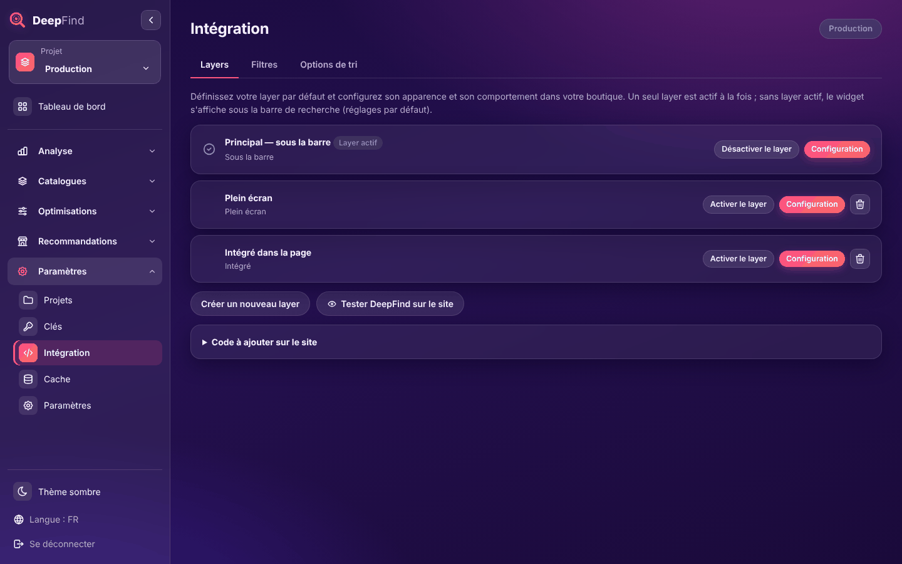

Un **layer** est une façon d'afficher la fenêtre de recherche. Un seul est actif à la fois ; **sans layer actif**, le widget s'affiche sous la barre de recherche avec les réglages du code du site.

| Mise en page | Description |
|---|---|
| **Sous la barre** | S'ouvre juste sous la barre de recherche du site, le reste de la page est assombri |
| **Plein écran** | Occupe toute la page, avec sa propre barre de recherche |
| **Flottant** | Panneau centré au-dessus de la page assombrie |
| **Intégré** | Les résultats prennent la place du contenu d'un bloc du site (ex. `main#maincontent`) |

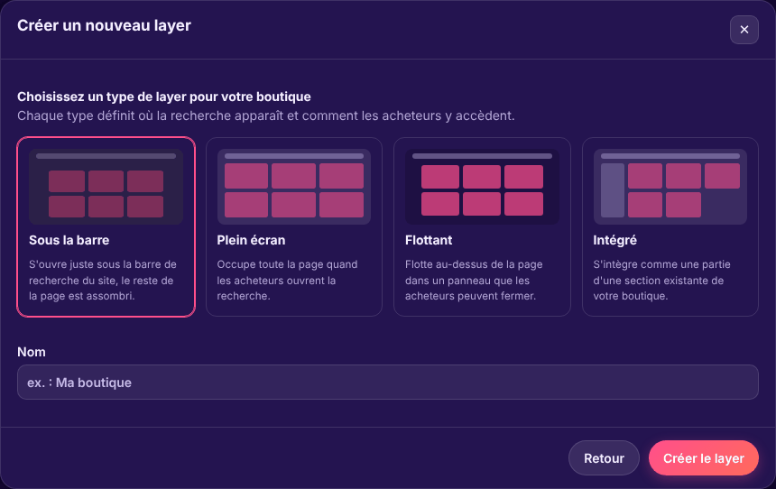

- **« Créer un nouveau layer »** : choix de la mise en page et du nom. Le premier layer créé est activé.
- **« Activer / Désactiver le layer »**, **« Configuration »**, corbeille (layer inactif seulement).
- **« Tester DeepFind sur le site »** : voir plus bas.
- **« Code à ajouter sur le site »** : le code de la section 4, avec votre clé et le bon numéro de version.

### Paramètres d'un layer

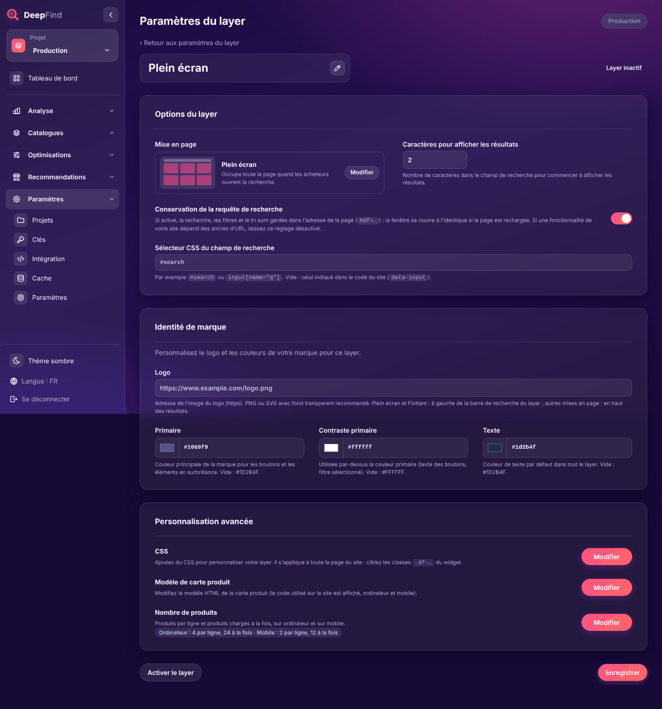

**Options du layer**
- **Mise en page** : le format actuel, et « Modifier » pour en changer (mêmes illustrations qu'à la création).
- **Caractères pour afficher les résultats** (1 à 10).
- **Conservation de la requête de recherche** : la recherche, les filtres et le tri sont gardés dans l'adresse de la page (`#df=…`), et la fenêtre se rouvre à l'identique si la page est rechargée. Laissez-le désactivé si une fonctionnalité du site utilise les ancres d'URL.
- **Sélecteur CSS du champ de recherche** (vide : celui du code du site).
- **Bloc d'affichage** (Intégré), **écart sous la barre** (Sous la barre).
- **Largeur maximale de la fenêtre** (sauf Plein écran) : en **% de l'écran** (par défaut, de 10 à 100) ou en **pixels** (320 à 3 000). Vide : largeur par défaut. Sur mobile, la fenêtre prend toute la largeur.

**Identité de marque** : logo (adresse https, affiché à gauche de la barre de recherche en Plein écran et Flottant, en haut des résultats sinon) et couleurs **primaire**, **contraste primaire** (texte sur la couleur primaire) et **texte**.

**Personnalisation avancée**
- **CSS** : ajouté à la page du site, en version **Ordinateur** et **Mobile** (900 px de large ou moins). Mobile vide : la version ordinateur s'applique partout.
- **Modèle de carte produit** (Ordinateur et Mobile) : le code HTML **réellement utilisé** est affiché ; modifiez-le puis enregistrez. « Réinitialiser » remet le modèle d'origine.
- **Nombre de produits** : produits **par ligne** (ordinateur : automatique ou 1 à 8 ; mobile : 1 à 3) et produits **chargés à la fois** (4 à 48), avec un aperçu de la grille.

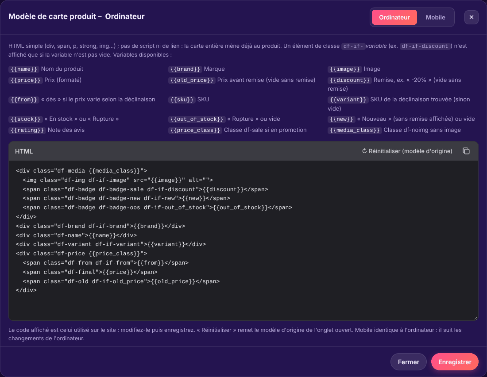

**Modèle de carte produit** :
- HTML simple (div, span, p, strong, img…). Les scripts, événements (`onclick`…) et liens `javascript:` sont retirés à l'enregistrement, puis de nouveau par le widget. Pas de lien : la carte entière mène déjà au produit.
- Variables (valeurs échappées) : `{{name}}`, `{{brand}}`, `{{image}}`, `{{price}}`, `{{old_price}}`, `{{discount}}`, `{{from}}`, `{{sku}}`, `{{variant}}`, `{{stock}}`, `{{out_of_stock}}`, `{{new}}`, `{{rating}}`, `{{price_class}}`, `{{media_class}}`.
- Un élément de classe **`df-if-`*variable*** (ex. `df-if-discount`) n'est affiché que si la variable n'est pas vide. Une image de classe `df-img` change au survol si le produit a une seconde image (désactivable : Paramètres › Widget sur le site).
- Un modèle identique à l'origine n'est pas enregistré : le layer suit alors le modèle d'origine.

### Filtres

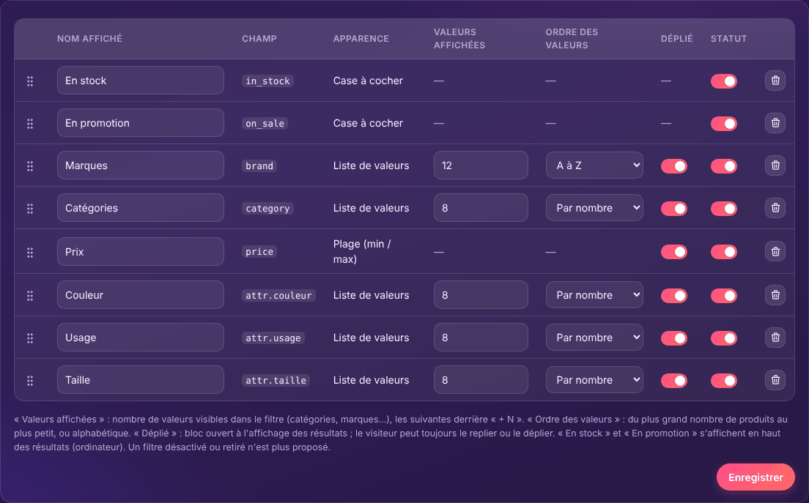

- **« + Ajouter un filtre »** : champ (principaux : en stock, en promotion, marques, catégories, prix ; puis les attributs marqués « filtrables » dans le mapping), nom affiché, valeurs affichées, ordre des valeurs, déplié par défaut, statut. La corbeille retire un filtre.
- **Ordre** des filtres par glisser-déposer.
- **Valeurs affichées** : nombre de valeurs visibles dans un filtre de type liste, les suivantes derrière « + N ».
- **Ordre des valeurs** : **par nombre** de produits (du plus grand au plus petit) ou **A à Z**. Les valeurs proposées sont toujours celles qui ont le plus de produits (plus celles déjà choisies par le visiteur).
- **Déplié** : bloc ouvert à l'affichage des résultats ; le visiteur peut toujours le replier ou le déplier.
- **Prix** : deux champs (min / max) et un curseur à deux poignées, avec « Réinitialiser » et « Valider ».
- Tant que la liste n'a jamais été enregistrée, tous les filtres disponibles sont proposés. Ensuite, seuls les filtres ajoutés le sont : un nouvel attribut importé apparaît dans « Ajouter un filtre ».

### Options de tri

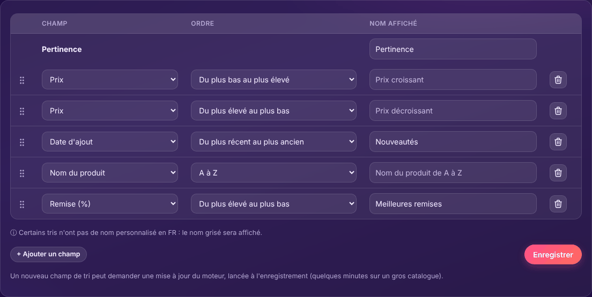

- « Pertinence » est toujours proposé en premier (nom modifiable).
- Pour chaque tri : le **champ** (principaux : prix, nom, date d'ajout, remise, marque, ventes 30 jours, note des avis ; puis les autres), l'**ordre** selon son type (A à Z / Z à A, du plus bas au plus élevé, du plus récent au plus ancien) et le **nom affiché** (vide : nom par défaut grisé).
- Ordre des tris par glisser-déposer. La marge et le score interne ne sont jamais proposés.
- Un nouveau champ de tri peut demander une mise à jour du moteur, lancée à l'enregistrement (quelques minutes sur un gros catalogue).

### Tester sur le vrai site (favori « Tester DeepFind »)

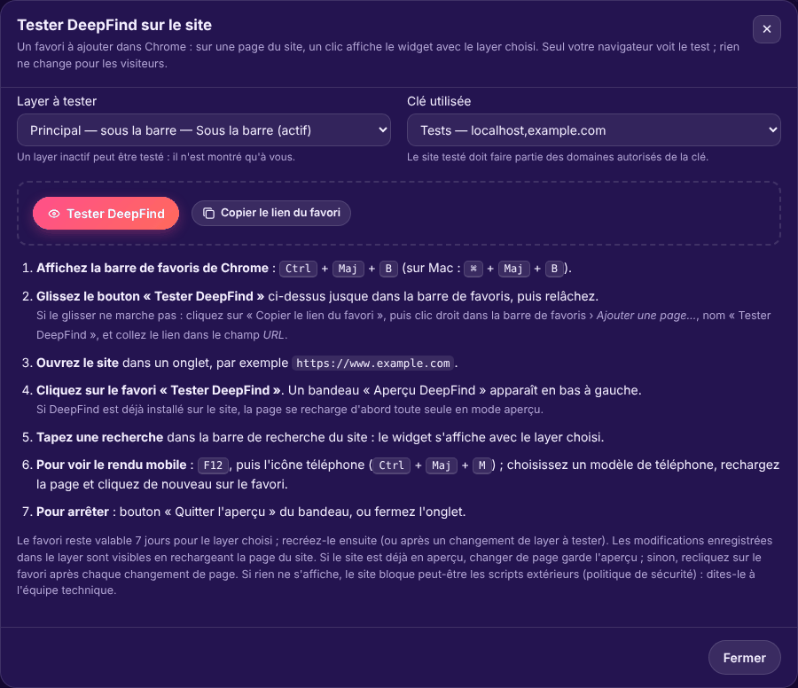

Un favori à ajouter dans Chrome : sur une page du site, un clic affiche le widget avec le layer choisi, **même inactif**. Seul votre navigateur voit le test.

1. Dans la fenêtre « Tester DeepFind sur le site », choisissez le **layer** et la **clé** (le site doit faire partie de ses domaines autorisés).
2. Affichez la barre de favoris de Chrome (`Ctrl` + `Maj` + `B`) et **glissez-y le bouton « Tester DeepFind »** (ou copiez le lien et créez le favori à la main).
3. Ouvrez le site et **cliquez sur le favori**. Une pastille « DeepFind » apparaît en haut à droite, avec « Quitter l'aperçu ».
4. Si DeepFind est déjà installé sur le site, la page se recharge en aperçu et le reste de page en page dans l'onglet ; sinon, recliquez sur le favori après chaque changement de page.

Le favori contient un jeton signé, lié au projet et au layer, valable **7 jours**. Si rien ne s'affiche, le site bloque peut-être les scripts extérieurs (politique de sécurité du site).

### Démo du widget

**Recommandations › Démo du widget** affiche le widget sur une page de démonstration. La liste **« Layer testé »** propose le layer actif (en premier, choisi par défaut), les autres layers et « Aucun layer ». Le bloc principal de la page s'appelle `main#maincontent`, comme sur Magento, pour tester un layer « Intégré ».

## 8. Pertinence et mise en avant

### Pertinence & classement


1. **Correspondance des mots**, en trois modes :
   - *Exacts, sinon approchants signalés* (par défaut) : tous les mots doivent être trouvés. Sinon, des produits approchants sont proposés avec la mention « Aucun résultat exact », et la recherche compte comme « sans résultat exact » dans les statistiques.
   - *Exacts uniquement* : tous les mots, sinon aucun résultat.
   - *Le plus de résultats possible* : le moteur retire des mots, au risque de résultats sans rapport.

   Un seuil **« Pertinence minimum »** (0 à 1) peut écarter les produits trop peu pertinents. Réglez-le en regardant la colonne « Pertinence » de l'aperçu interne.
2. **Importance des champs dans la recherche texte** : numérotez les champs (nom, marque, SKU, mots-clés, catégories, attributs, descriptions). Un mot trouvé dans un champ bien classé fait remonter le produit. Un champ peut être rendu non cherchable. *Appliqué immédiatement au moteur.*
   - **Bonus « mot recherché au début du nom »** (0,5 par défaut) : DeepFind réordonne les premiers résultats. Un mot de la recherche en 1re position du nom vaut 1, en 2e 1/2, en 3e 1/3… La pagination reste cohérente.
   - Meilisearch classe par *ordre* des champs, pas par poids. Pour que cet ordre compte plus, activez **« Priorité au champ où le mot est trouvé »**.
3. **Score métier** : un poids par critère (0 pour l'ignorer) : en stock, rentabilité, popularité (ventes 30 jours du flux), **clics dans la recherche sur 30 jours**, nouveauté, boosts.
   - **Recalcul** : à chaque import, **chaque nuit à 4 h 30** (interrupteur), ou tout de suite avec **« Enregistrer et recalculer les scores »**. Ce recalcul relit les produits indexés, sans retélécharger les flux, et se suit dans **Imports**.
4. **Importance du score métier face à la pertinence** : *faible* (il ne départage que des produits aussi pertinents, recommandé), *moyenne* ou *forte*. Interrupteur **Ruptures en fin de liste**.

### Règles de boost


- Une règle a un nom, un statut, un **coefficient** (1 = neutre, 2 = double, 0,5 = moitié, 0 = en fin de liste), des **termes de recherche** facultatifs (exacte : la recherche est exactement ce terme ; large : elle contient tous ses mots) et des **conditions** (toutes, ou au moins une).
- **Conditions** :
  - champ à valeurs (marque, catégorie, type, SKU, attributs) : **est** (valeurs cochées), **contient**, **ne contient pas**, **commence par**, **finit par**, sans tenir compte des majuscules ni des accents ;
  - pour **contient**, **commence par** et **finit par**, plusieurs textes peuvent être saisis (Entrée entre chaque) : il suffit que l'un d'eux corresponde (OU). Avec **ne contient pas**, le produit ne doit contenir aucun d'eux ;
  - **nom du produit** : contient, ne contient pas, commence par, finit par (sans majuscules ni accents). Exemple : Marque *est* ECOFLOW **et** Nom du produit *contient* « batterie » booste les batteries sans les accessoires ;
  - champ oui/non (disponibilité, en promotion, nouveauté) : valeurs à cocher ;
  - champ chiffré (prix, remise, marge, ventes) : supérieur ou égal, inférieur ou égal.
- La liste des valeurs à cocher montre les 100 premières ; tapez dans « Rechercher… » pour chercher parmi **toutes** les valeurs du catalogue.
- La pertinence des produits concernés est multipliée par le coefficient (plusieurs règles se multiplient), lors du réordonnancement des premiers résultats, en tri « pertinence » uniquement.
- **Boost rapide d'un produit** : dans l'aperçu interne, la liste « Boost » crée une règle « Produit SKU » (toutes les recherches).

### Résultats personnalisés

Pour des termes de recherche (correspondance exacte ou large), en continu ou sur une période :
- produits **affichés en premier** (ou **uniquement** ces produits), choisis un par un (dans l'ordre voulu) ou par règle (marque, catégorie, attribut, stock, prix…) ;
- produits **exclus** ;
- suivi des **impressions**, des **clics** et du **CTR**.

« Épingler » dans l'aperçu interne crée ou complète un résultat « Recherche « … » ». L'ordre imposé ne vaut qu'en tri « pertinence ». Import CSV des anciennes règles (`samples/boosts.csv`).

### Règles selon la page

**Recommandations › Règles** adapte les résultats à la **page du site** où se trouve le visiteur, sans mot-clé ni période. Exemple : sur les pages dont l'adresse contient `/nautisme/`, ne proposer que la catégorie Nautisme.

Une règle comprend :
1. **Pages concernées** : une ou plusieurs adresses (chemin sans le nom de domaine, majuscules ignorées) qui **contiennent**, **commencent par**, **finissent par** ou **sont exactement** un texte ; il suffit qu'une adresse corresponde. Une adresse complète collée (`https://www.example.com/fr/nautisme.html`) est réduite à son chemin.
2. **Action**, au choix :
   - **Filtre pré-coché** : seuls ces produits sortent au départ, avec un bandeau « Résultats limités à **Nautisme ✕** » ; un clic sur ✕ élargit à tout le catalogue (« Revenir à Nautisme » le remet). Le texte du bandeau se règle dans la règle ;
   - **Afficher uniquement** ces produits (filtre imposé, non retirable) ;
   - **Exclure** ces produits.
3. **Produits concernés** : conditions comme pour les résultats personnalisés (marque, catégorie, type, SKU, attributs : *est* / *n'est pas* ; disponibilité, promotion, nouveauté ; prix ou marge supérieur / inférieur à), toutes ou au moins une.

**Fonctionnement**
- Un interrupteur active ou désactive chaque règle. **Seule la première règle active de la liste dont une adresse correspond s'applique** : l'ordre se change par glisser-déposer (enregistré au lâcher).
- La règle devient un filtre du moteur : nombre de résultats, pagination et filtres du widget (marques, catégories…) restent justes. Elle s'ajoute aux autres réglages (résultats personnalisés, boosts, filtres choisis par le visiteur). Les articles de blog ne sont pas concernés.
- Rien ne change tant que le visiteur n'a rien tapé.
- **Vérifier une règle** : **Aperçu interne**, champ « Page du site » (ex. `/fr/nautisme/kayak.html`) : la règle appliquée est indiquée au-dessus des résultats.
- Nécessite le widget `?v=23` ou plus récent : il envoie le chemin de la page (sans paramètres) avec chaque recherche.

### Redirections

Nom, statut, URL de destination, termes (exacts ou larges), en continu ou sur une période.
- Un lien vers la page est proposé en haut des résultats ; en **redirection automatique**, la recherche validée (Entrée, loupe) ouvre directement la page.
- **Ouvrir dans un nouvel onglet** : sinon, la page remplace la page actuelle. Si le navigateur bloque le nouvel onglet, la page s'ouvre dans l'onglet actuel.
- Import CSV `requete;url` (`samples/redirections.csv`).

### Bannières

Image ordinateur + image mobile + lien (téléversement ou adresse), ou code HTML (scripts, événements et liens `javascript:` retirés), en haut des résultats pour des termes de recherche ou **par défaut**, en continu ou sur une période. Suivi des **affichages**, **clics** et **CTR**. Les images sont stockées dans `public/uploads/banners/` (à sauvegarder, et accessible en écriture par PHP).

**Ordre de classement :** le nombre de mots trouvés passe en premier ; les résultats personnalisés passent avant le reste. Vérifiez l'effet de vos réglages dans l'**aperçu interne**.

## 9. Anti-robots

À chaque appel de l'API publique :

1. **IP bloquée** (manuellement ou automatiquement) → réponse 403.
2. **User-agent de robot ou vide** (curl, python, scrapy, navigateur « headless »…) → réponse 403. La liste se modifie dans Paramètres.
3. **Seuils par IP** : 90 requêtes par minute, 1 500 par heure, et 15 fois la même requête par minute (valeurs par défaut) → réponse 429. Le widget affiche alors « patientez ».
4. **Blocage automatique** : 3 minutes en dépassement sur une heure, ou une rafale supérieure à 5 fois la limite par minute → blocage pendant 60 minutes.

**Fonctionnement :**
- Les compteurs sont en mémoire (APCu ou Redis) : un robot ne provoque **aucune écriture en base** au-delà d'une alerte par minute.
- La saisie normale d'un visiteur (une requête toutes les ~180 ms de frappe) reste très en dessous des seuils.
- Si un proxy, un CDN ou un équilibreur de charge est placé devant Apache, renseignez `TRUSTED_PROXIES`. Sinon, tous les visiteurs auront la même IP.
- Les IP de vos bureaux ou d'un outil de supervision peuvent être exemptées : Paramètres › « IP jamais limitées ».
- Un déblocage fait directement en base de données n'est pris en compte qu'au bout de 60 secondes (cache). Le bouton « Débloquer » de l'extranet agit immédiatement.

## 10. Journaux de recherche et RGPD

- **Contenu enregistré** : chaque recherche « finale » (pas chaque lettre tapée : « pa », « pal », « palm » sont marquées comme intermédiaires), avec les filtres, le nombre de résultats, le temps de réponse, le user-agent et les clics.
- **Adresse IP** : jamais stockée en clair. On conserve une **empreinte** (HMAC avec `APP_SECRET`) pour compter et bloquer, et une **IP tronquée** (`203.0.113.x`) pour l'affichage. Aucun cookie.
- **Conservation** : 90 jours par défaut (Paramètres), purge automatique chaque nuit (`logs:purge`).
- **Mesure d'audience** (Analyse › Audience) : aucun cookie ni stockage sur l'appareil, aucune IP enregistrée ; empreinte valable une journée (clé secrète du jour détruite à la fin de la journée), puis seuls des totaux quotidiens sont gardés. Désactivable entièrement ou par type de mesure.
- **À faire valider** par votre référent RGPD / DPO : durée de conservation, mention dans la politique de confidentialité du site, et l'absence de consentement pour la mesure d'audience (méthode conçue pour entrer dans l'exemption de la CNIL pour la mesure d'audience, à confirmer). Ce README ne constitue pas un avis juridique.

## 11. Commandes

```bash
php bin/console help
```

| Commande | Rôle |
|---|---|
| *(option commune)* `--project=CODE` | Projet concerné (par défaut le premier) ; `import:run --all` sans `--project` traite les flux actifs de tous les projets |
| `check` | Vérifie PHP, extensions, base, Meilisearch, droits |
| `install` | Crée ou met à jour les tables (sans risque si relancée) et les sources par défaut |
| `admin:token` | Génère `ADMIN_TOKEN` et `APP_SECRET` |
| `key:create --name=… --origins=example.com --langs=fr` | Crée une clé publique |
| `schedule:run [--work]` | **À lancer chaque minute par cron** : déclenche les imports planifiés dans l'extranet (`--work` : les exécute aussi, sans Supervisor) et transforme la mesure d'audience des jours passés en totaux quotidiens |
| `import:run --all` ou `--source=CODE`, `--type=full\|delta` | Import immédiat en ligne de commande |
| `queue:work [--once]` | Traite les imports demandés depuis l'extranet |
| `scores:refresh [--lang=fr]` | Recalcule les scores métier (poids, boosts, clics) sans relire les flux |
| `rules:sync` | Renvoie les synonymes au moteur |
| `rules:import --lang=fr --synonyms=… --rules=… --redirects=… [--replace]` | Import CSV en ligne de commande |
| `logs:purge` | Purge des journaux |

## 12. Tests

Les tests utilisent une **base MySQL de test dédiée**, dont toutes les tables sont supprimées à chaque lancement : n'utilisez **jamais** la base de production. Ils utilisent aussi un **faux Meilisearch** (`tests/fake-meili.php`), qui imite l'API avec une recherche simplifiée.

```sql
CREATE DATABASE deepfind_test CHARACTER SET utf8mb4;
CREATE USER 'df_test'@'localhost' IDENTIFIED BY 'df_test_pw';
GRANT ALL ON deepfind_test.* TO 'df_test'@'localhost';
```

```bash
bash tests/run.sh
```

Ce script lance environ 190 tests unitaires et d'intégration : mapping, regroupement parents/enfants, XML tronqué ou malveillant, API, filtres, règles, SKU, origine, robots, projets, layers, filtres et tris du widget, désactivation automatique, aperçu. Il échoue si un avertissement PHP apparaît dans le journal du serveur web.

**Test dans le navigateur (facultatif, nécessite Node.js et Playwright)**

Lancez d'abord `tests/run.sh`. Ensuite, dans deux terminaux, démarrez le faux Meilisearch et le serveur web de développement :

```bash
FAKE_MEILI_DIR=tests/_tmp/meili php -S 127.0.0.1:7799 tests/fake-meili.php
```

```bash
DEEPFIND_ENV_FILE=$PWD/tests/_tmp/.env php -d apc.enable_cli=1 -S 127.0.0.1:8080 -t public public/index.php
```

Dans un troisième terminal, démarrez le worker des imports (le test lance un import manuel et suit son avancement) :

```bash
DEEPFIND_ENV_FILE=$PWD/tests/_tmp/.env php bin/console queue:work --max-time=900 --sleep=1
```

Puis lancez le test du navigateur :

```bash
node tests/e2e.cjs http://localhost:8080 tests/_tmp/screens
```

Il vérifie (environ 90 contrôles) la connexion, toutes les pages, les thèmes, le menu replié, les actions principales, le widget (défilement, filtres, mobile) et prend des captures d'écran.

> Dernière exécution complète : PHP 8.3, MariaDB 10.11, APCu, faux Meilisearch. Le faux Meilisearch ne reproduit pas exactement la pertinence du vrai. Après installation, validez la qualité des résultats sur le serveur de recette avec le vrai Meilisearch et votre catalogue (**Aperçu interne**).

## 13. Dépannage

| Symptôme | Piste |
|---|---|
| Le widget n'affiche rien | Console du navigateur : `invalid_key` (clé), `origin_not_allowed` (ajoutez le domaine dans la clé), `bad_user_agent` / `ip_blocked` (Robots & blocages), `project_disabled` (Projets) |
| `engine_unavailable` (503) | `systemctl status meilisearch`, `curl 127.0.0.1:7700/health`, `MEILI_MASTER_KEY` identique des deux côtés |
| Un réglage d'affichage n'apparaît pas sur le site | Délai de 5 minutes au plus ; vérifiez aussi le numéro `?v=` du script (section 4) |
| Import « Bloqué » | Le flux contient beaucoup moins de produits vendables qu'avant (seuil en Paramètres). Vérifiez le flux, ou augmentez temporairement le seuil |
| Import « En attente » qui ne démarre pas | Le worker Supervisor ne tourne pas (`supervisorctl status`), ou la ligne cron `schedule:run --work` est absente |
| Import en échec « HTTP 401 » | Flux protégé par mot de passe : renseignez ou corrigez l'utilisateur et le mot de passe (fiche de la source, **Tester la connexion**) |
| Produits rejetés | Imports › détail : motifs (SKU manquant, prix nul, enfant sans parent…), puis **Tester** le mapping |
| Un produit a disparu des résultats | Aperçu interne avec « Désactivés » : « désactivé manu » (bouton Activer) ou « désactivé auto » (absent du dernier flux complet) |
| Tous les visiteurs bloqués ensemble | Un proxy ou CDN est devant Apache : renseignez `TRUSTED_PROXIES` |
| Un paramètre modifié n'agit pas | Les paramètres sont mis en cache 60 s ; le classement métier demande un recalcul des scores ou un import |

## 14. Limites connues

- **Accès à l'extranet** : un jeton unique, sans comptes utilisateurs ni journal des actions d'administration.
- **Flux delta** : met à jour prix, stock, champs simples et suppressions. Les nouveaux produits, catégories et attributs arrivent à l'import complet ; la réactivation d'un produit désactivé auto aussi.
- **Recherche** : pas de recherche sémantique ou IA, pas de suggestions de requêtes.
- **Statistiques** : recherches, clics et audience (visiteurs, appareils) ; pas encore de suivi des ventes (ajouts au panier, commandes) ni d'envoi d'événements à Google Analytics.
- **Copie entre projets** : n'inclut pas encore les layers, filtres, tris ni les règles selon la page.
- **Tests** : faits sous PHP 8.3 avec un **faux** Meilisearch. Il faut valider sous PHP 8.5 et le vrai Meilisearch sur le serveur de recette.
- **Module Magento** : aucun module n'est fourni pour générer le flux. Utilisez une extension de flux du marché ou un développement interne qui produit le format décrit ci-dessus.
