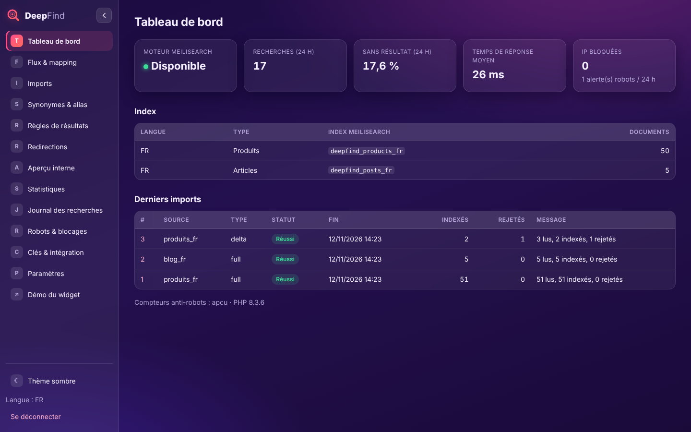
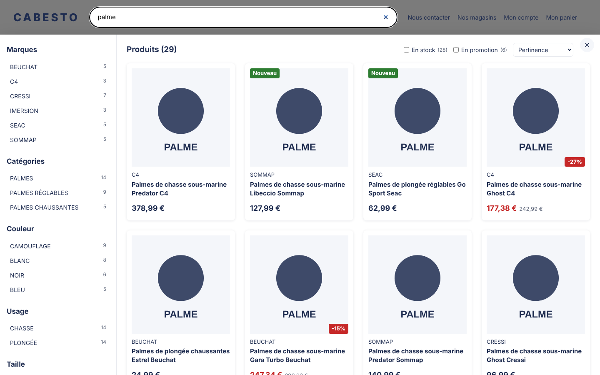
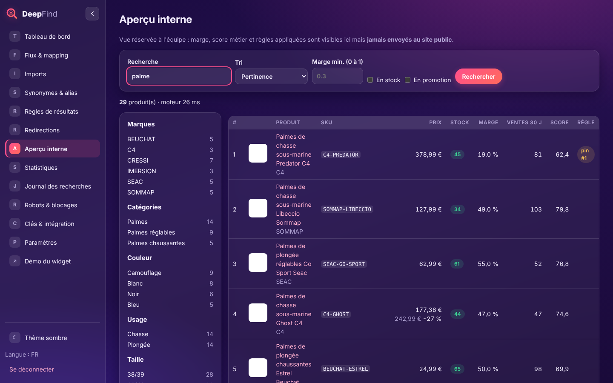
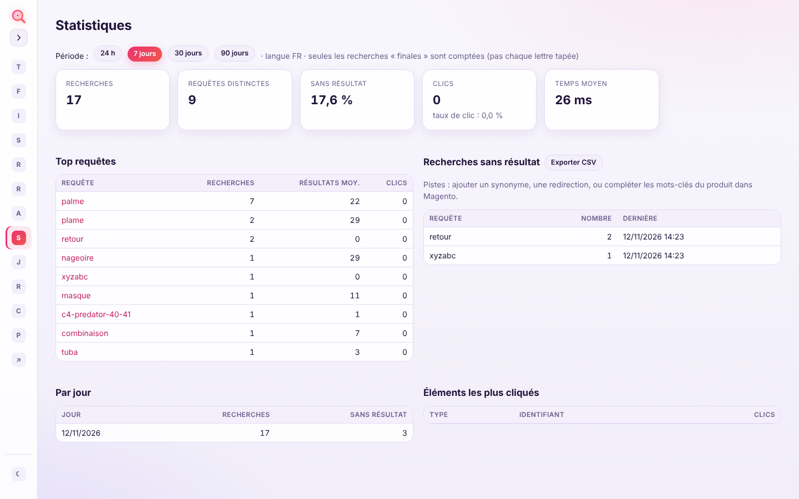
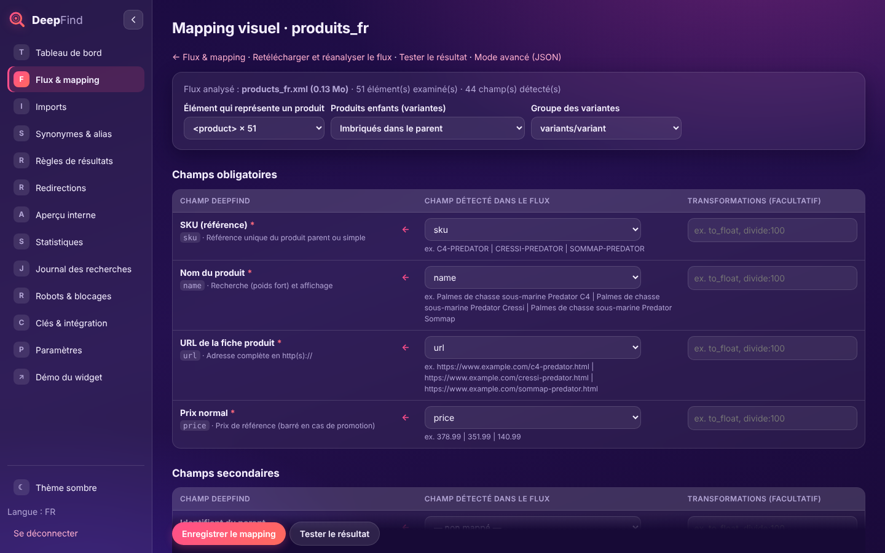
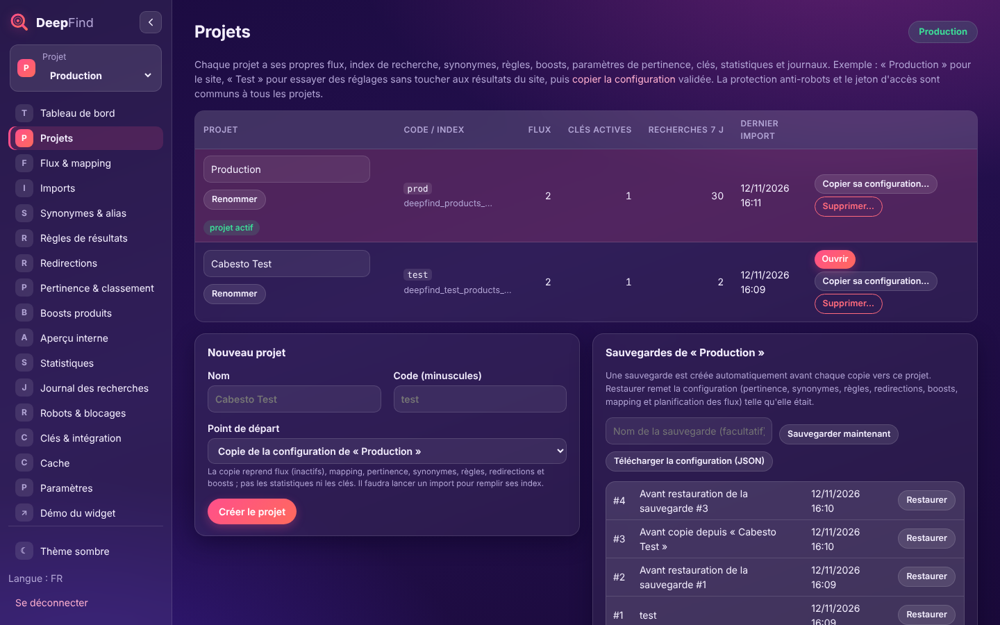
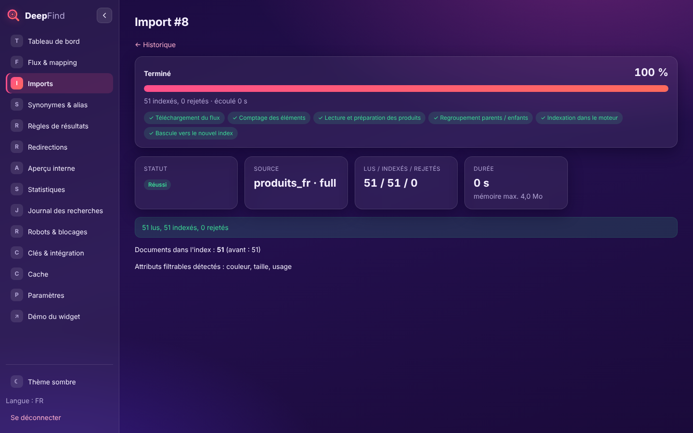
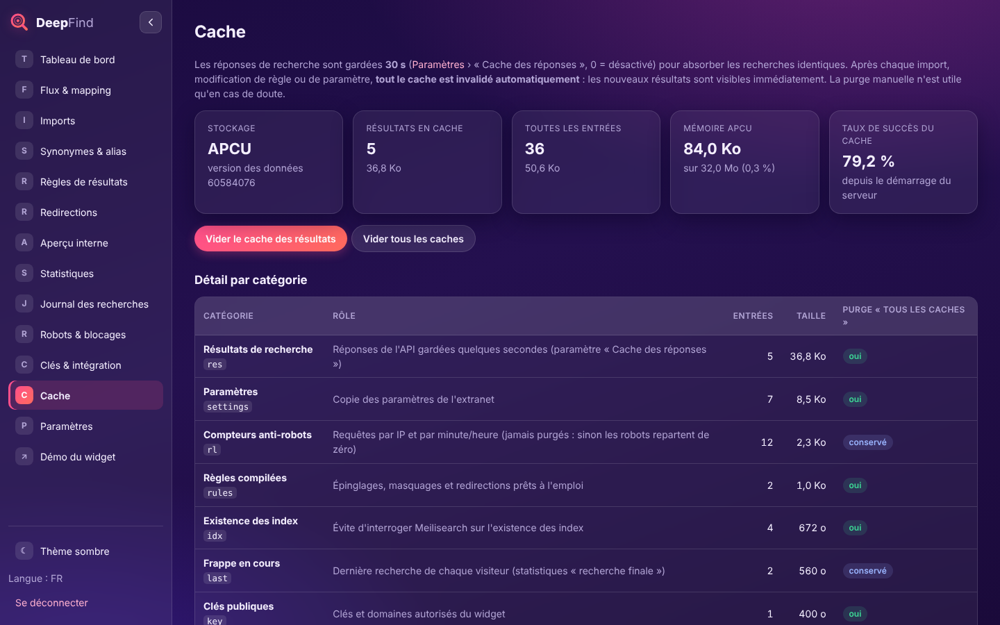

# DeepFind

Moteur de recherche instantanée pour le site Cabesto, dans l'esprit de Doofinder :

- **Recherche** : tolérance aux fautes de frappe, synonymes et alias, recherche par SKU (parent ou enfant) et EAN.
- **Règles de résultats** : produits épinglés, remontés ou masqués, redirections.
- **Filtres** : marques, catégories, attributs, stock, promotion.
- **Panneau de résultats** : chargement au défilement, articles de blog dans la colonne de gauche.
- **Extranet de gestion** : flux, mapping, imports, règles, statistiques, journal des recherches, robots et blocages.
- **Protection anti-robots** : seuils d'appels par IP et blocage automatique.



| Widget sur le site | Aperçu interne (marge, score) | Thème clair, menu replié |
|---|---|---|
|  |  |  |

> ⚠️ Les flux fournis dans `samples/` sont **fictifs** : produits, prix, stocks et marges sont inventés. Les noms de marques ne servent qu'à illustrer.
> Testez toute installation ou mise à jour sur un serveur de **recette** avant la production.

---

## Sommaire

1. [Comment ça marche](#1-comment-ça-marche)
2. [Logiciels à installer](#2-logiciels-à-installer)
3. [Installation pas à pas](#3-installation-pas-à-pas)
4. [Intégrer le widget sur le site Magento](#4-intégrer-le-widget-sur-le-site-magento)
5. [Formats des flux et mapping](#5-formats-des-flux-et-mapping)
6. [Utiliser l'extranet](#6-utiliser-lextranet)
7. [Anti-robots](#7-anti-robots)
8. [Journaux de recherche et RGPD](#8-journaux-de-recherche-et-rgpd)
9. [Commandes](#9-commandes)
10. [Tests](#10-tests)
11. [Dépannage](#11-dépannage)
12. [Limites connues de la V1](#12-limites-connues-de-la-v1)

---

## 1. Comment ça marche

```
 Magento 2.4.7 ──flux XML produits (complet + delta)──┐
 Magefan Blog ──flux XML articles─────────────────────┤
                                                      ▼
                           bin/console import:run (cron / bouton extranet)
                                                      │  lecture en flux, regroupement parents/enfants,
                                                      │  calcul prix « dès », stock, promo, score métier
                                                      ▼
                                              Meilisearch (127.0.0.1:7700, jamais exposé)
                                                      ▲
 Navigateur ─ widget JS (clé publique) ─► /api/v1/search (PHP) ─┘   + MySQL : config, règles, journaux
                                           • contrôle clé + domaine
                                           • anti-robots (APCu/Redis)
                                           • règles (épingler/masquer/redirection)
                                           • ne renvoie QUE les champs d'affichage (jamais la marge)
```

- **Meilisearch** fait la recherche elle-même (index en mémoire, réponses en quelques millisecondes).
- **PHP / Apache / MySQL**, que vous avez déjà, servent l'API, l'extranet, les imports et les journaux.
- **Aucune dépendance Composer** : le code n'utilise que PHP et ses extensions standard.
- Un **import complet** construit un index temporaire, vérifie qu'il n'a pas perdu trop de produits, puis bascule instantanément. Les visiteurs ne voient aucune coupure, et un flux vide ou cassé ne vide jamais la recherche.

## 2. Logiciels à installer

Sur la VM. Commandes pour Debian/Ubuntu ; adaptez-les à votre distribution.

| Logiciel | Pourquoi | Obligatoire |
|---|---|---|
| PHP **8.2 minimum** (8.5 visé) en **PHP-FPM** | Application | ✅ |
| Extensions PHP : `pdo_mysql`, `curl`, `xml` (xmlreader, dom, simplexml), `mbstring`, `zlib` | Application | ✅ |
| Extension PHP **`apcu`** | Compteurs anti-robots et cache, en mémoire | Fortement conseillé (sinon Redis ou repli MySQL) |
| OPcache activé | Performances PHP | Fortement conseillé |
| MySQL 8 ou MariaDB 10.6+ | Configuration, règles, journaux | ✅ (déjà présent) |
| Apache 2.4 : `proxy_fcgi`, `headers`, `deflate`, `http2`, `ssl` | Serveur web | ✅ (déjà présent) |
| **Meilisearch** 1.x (**1.10 minimum**) | Moteur de recherche | ✅ **à installer** |
| Supervisor | Traiter les imports lancés depuis l'extranet | Conseillé (sinon une ligne cron) |
| Redis + `php-redis` | Uniquement si plusieurs serveurs web | Facultatif |

**Mémoire vive pour environ 70 000 produits :** comptez 8 Go sur la VM, dont 4 Go pour Meilisearch. Prévoyez 40 Go de disque SSD.

> PHP 8.5 : sur Debian/Ubuntu, les paquets viennent en général du dépôt de Ondřej Surý (`packages.sury.org` / PPA `ondrej/php`).
> Vérifiez la disponibilité de `php8.5-apcu` au moment de l'installation. S'il n'existe pas encore, mettez `RATE_STORE=redis` (avec `php8.5-redis`) ou `RATE_STORE=mysql` dans `.env`.
> Le code a été testé sous **PHP 8.3** (pas d'environnement 8.5 disponible pour les tests). Il n'utilise aucune fonction dépréciée en 8.5 à notre connaissance. Lancez `php bin/console check`, puis la suite de tests, sur votre VM.

## 3. Installation pas à pas

Toutes les commandes sont à lancer en root (ou avec `sudo`) **sur le serveur de recette d'abord**.

### 3.1 PHP et extensions

```bash
apt install php8.5-fpm php8.5-cli php8.5-mysql php8.5-curl php8.5-xml php8.5-mbstring php8.5-apcu supervisor
```

Dans `/etc/php/8.5/fpm/conf.d/` (fichier `99-deepfind.ini`), ajoutez :

```ini
opcache.enable=1
opcache.memory_consumption=128
opcache.validate_timestamps=1
apc.enabled=1
apc.shm_size=64M
memory_limit=512M
```

### 3.2 Meilisearch

1. Téléchargez le binaire Linux de la **dernière version stable 1.x** depuis <https://github.com/meilisearch/meilisearch/releases>. Notez le numéro de version pour pouvoir le reproduire.
2. Installez-le :

```bash
install -m 755 meilisearch-linux-amd64 /usr/local/bin/meilisearch
```

```bash
useradd --system --home /var/lib/meilisearch --shell /usr/sbin/nologin meilisearch
```

```bash
mkdir -p /var/lib/meilisearch && chown meilisearch: /var/lib/meilisearch
```

3. Créez `/etc/meilisearch.env` avec `MEILI_MASTER_KEY=…`. Utilisez une valeur longue et aléatoire (`openssl rand -hex 32`), puis :

```bash
chmod 600 /etc/meilisearch.env && chown meilisearch: /etc/meilisearch.env
```

4. Copiez `deploy/meilisearch.service` dans `/etc/systemd/system/`, puis :

```bash
systemctl daemon-reload && systemctl enable --now meilisearch
```

5. Vérifiez : `curl http://127.0.0.1:7700/health` doit répondre `{"status":"available"}`.

> Meilisearch n'écoute que sur `127.0.0.1` : il n'est **jamais** accessible depuis Internet. Ne le changez pas.

### 3.3 Base de données

```sql
CREATE DATABASE deepfind CHARACTER SET utf8mb4 COLLATE utf8mb4_unicode_ci;
CREATE USER 'deepfind'@'localhost' IDENTIFIED BY 'MOT_DE_PASSE_FORT';
GRANT ALL ON deepfind.* TO 'deepfind'@'localhost';
```

### 3.4 Application

```bash
git clone <URL_DU_DEPOT> /var/www/deepfind
```

```bash
cd /var/www/deepfind && cp .env.example .env && chmod 640 .env
```

```bash
php bin/console admin:token
```

Copiez les valeurs `ADMIN_TOKEN` et `APP_SECRET` affichées dans `.env`, puis complétez `DB_*`, `MEILI_MASTER_KEY` (la même que l'étape 3.2) et `APP_URL`.

```bash
chown -R www-data: var && chgrp www-data .env
```

```bash
php bin/console check
```

```bash
php bin/console install
```

### 3.5 Apache

Copiez `deploy/apache-vhost.conf` dans `/etc/apache2/sites-available/deepfind.conf` et adaptez le nom de domaine et les certificats. Ensuite :

```bash
a2enmod proxy_fcgi setenvif headers deflate http2 ssl && a2enconf php8.5-fpm
```

```bash
a2ensite deepfind && apachectl configtest && systemctl reload apache2
```

Conseillé : limitez `/admin` aux IP du siège ou du VPN (bloc commenté dans le fichier).

### 3.6 Worker et tâches planifiées

```bash
cp deploy/supervisor-worker.conf /etc/supervisor/conf.d/deepfind-worker.conf && supervisorctl reread && supervisorctl update
```

Ajoutez ensuite les lignes de `deploy/crontab` dans la crontab de `www-data` (`crontab -u www-data -e`). Une seule ligne suffit pour les imports : le **planificateur** `schedule:run`, lancé chaque minute. Les horaires de chaque flux se règlent ensuite dans l'extranet (voir 3.7). Sans Supervisor, utilisez la variante `schedule:run --work`, indiquée dans le fichier.

### 3.7 Premier import

1. Connectez-vous à `https://search.cabesto.com/admin` avec le jeton `ADMIN_TOKEN`.
2. **Flux & mapping** : remplacez l'URL d'exemple de `produits_fr` par l'URL de votre flux Magento, puis faites de même pour `blog_fr`.
3. **Mapping** (mapping visuel) : DeepFind analyse le flux. Pour chaque champ (obligatoires en premier), choisissez à droite le champ du flux correspondant, puis enregistrez. Voir la section 5.
4. **Tester** : vérifiez que le mapping produit le bon document, sans rien indexer.
5. **Planification des imports** (dans la fiche du flux) : choisissez par exemple « Chaque nuit à 3 h 15 » pour l'import complet et « Toutes les 15 min de 6 h à 23 h » pour le delta.
6. **Import complet** pour un premier chargement immédiat, puis suivez l'avancement dans **Imports**.
7. **Clés & intégration** : créez une clé pour `cabesto.com`, puis testez avec **Démo du widget**.

## 4. Intégrer le widget sur le site Magento

Ajoutez ce code avant `</body>`, par exemple dans *Contenu › Design › Configuration › HTML Head › Scripts et feuilles de style* ou dans un bloc du thème :

```html
<script src="https://search.cabesto.com/widget/deepfind.js?v=5" defer
  data-key="pk_VOTRE_CLE_PUBLIQUE"
  data-lang="fr"
  data-input="#search"
  data-results-url="https://www.cabesto.com/fr/catalogsearch/result/?q="></script>
```

- **Activation** : au chargement, le widget demande à l'API (`/api/v1/config`) si le projet de la clé est actif. Il ne prend la main (fenêtre de recherche, neutralisation de l'autocomplétion d'origine) que si c'est le cas. **Projet désactivé** (page Projets) ou **API injoignable** : rien n'est modifié, la recherche d'origine du site fonctionne normalement. La réponse est gardée 1 min par le navigateur et 5 min dans la session du visiteur.
- Le widget s'accroche au champ de recherche existant. La fenêtre s'ouvre **juste sous la barre de recherche** (écart réglable : `data-gap="12"`), le reste de la page est assombri et la barre reste mise en avant et utilisable. Un clic sur le fond sombre ferme la fenêtre. Pour l'ouvrir sous un autre élément : `data-position="anchor" data-anchor="header.page-header"`.
- **Touche Entrée** : ouvre la page de résultats du site (Paramètres › Widget sur le site), ou, si ce réglage est désactivé, laisse seulement la fenêtre DeepFind. `data-enter="off"` / `"on"` force le comportement sur une page.
- **Clics** : chaque ouverture d'un produit ou d'un article depuis la fenêtre (clic, Ctrl/Cmd + clic, clic molette) est enregistrée. Les clics des 30 derniers jours entrent dans le score métier au recalcul (import, recalcul nocturne ou « Recalculer les scores »).
- **Autocomplétion d'origine du site** (panneau Magento « Suggestions de recherche », « Recent Searches »…) : neutralisée par défaut. Le widget intercepte les événements du champ avant les scripts du site, qui ne s'ouvrent donc plus ; les panneaux connus (`#search_autocomplete`, Amasty, Mirasvit, Smile ElasticSuite) sont en plus masqués. Si un autre panneau apparaît encore, ajoutez son sélecteur : `data-hide=".mon-panneau"` (clic droit sur le panneau › Inspecter pour trouver son `id` ou sa `class`). Pour garder l'autocomplétion d'origine : `data-native="keep"`. La touche Entrée envoie toujours le formulaire du site (ou va vers `data-results-url`).
- Il charge ses styles tout seul (`deepfind.css`). Les couleurs se changent via les variables `--df-*` du fichier CSS.
- **Fonctions** : attente de 180 ms après la frappe, annulation des requêtes dépassées, cache local, chargement au défilement, filtres marques/catégories/attributs, case « En stock », case « En promotion », tri par prix ou nouveauté, articles de blog, touche Entrée (redirection ou page « Tout voir »), touche Échap, version mobile avec bouton « Filtres ».
- **Statistiques de clics** : chaque clic est mesuré (`sendBeacon`), sans cookie. Un identifiant aléatoire est créé à chaque chargement de page.
- **Multilingue** : `data-lang="en"` et une clé autorisée pour `en`. Chaque langue a son propre index et sa propre source de flux.
- Après une mise à jour du widget, changez le numéro `?v=` (ex. `?v=5` en `?v=6`) pour forcer le rechargement par les navigateurs.

## 5. Formats des flux et mapping

Deux options pour les flux :

- **Le format DeepFind (recommandé)** : le mapping par défaut fonctionne sans modification. Exemples complets : `samples/products_fr.xml`, `samples/products_fr_delta.xml`, `samples/blog_fr.xml`.
- **Votre propre format** : vous adaptez le mapping JSON de la source. Exemple : `samples/mapping_flat_example.json` pour `samples/products_fr_flat.xml`.

**Règles communes :**
- Encodage UTF-8.
- Textes entre `<![CDATA[ ]]>`.
- Prix avec un point ou une virgule (les deux sont acceptés).
- Dates au format ISO 8601.
- Fichier `.xml` ou `.xml.gz`.
- Flux lu au fil de l'eau : taille illimitée.

### Produits : champs internes

| Champ | Type | Obligatoire | Usage |
|---|---|---|---|
| `id` | texte | conseillé | identifiant (entity_id) |
| `sku` | texte | ✅ | recherche exacte prioritaire |
| `type` | simple/configurable… | | info |
| `parent_id` | texte | flux à plat | rattachement d'un enfant à son parent |
| `enabled` | 0/1 | | 0 = ignoré |
| `name` | texte | ✅ | recherche (poids fort), affichage |
| `brand` | texte | conseillé | filtre « Marques » |
| `url`, `image`, `image_hover` | URL http(s) | url ✅ | affichage (utilisez l'image *cache* redimensionnée de Magento) |
| `short_description`, `description` | texte/HTML | | recherche (poids faible), le HTML est retiré |
| `ean` | texte | | recherche exacte |
| `price` | décimal | ✅ (ou final_price) | prix barré si promo |
| `final_price` | décimal | conseillé | prix affiché (exportez le **prix final** Magento, règles de prix catalogue incluses) |
| `in_stock`, `salable_qty` | oui/non, entier | conseillé | exportez la **quantité vendable MSI**. Pour `in_stock`, sont reconnus comme « en stock » : 1, un nombre > 0, oui/yes/true, « En stock », `in_stock`, `available`, `preorder`, `backorder` (Google Shopping) et `https://schema.org/InStock`. Tout le reste = rupture |
| `margin_rate` | 0 à 1 | | **classement uniquement, jamais envoyé au site** |
| `sales_30d` | entier | | popularité |
| `created_at` | date | | badge « Nouveau » et classement |
| `rating`, `reviews_count` | | | affichage |
| `search_keywords` | texte | | mots-clés en plus |
| `manual_boost` | -10 à +10 | | boost éditorial permanent |

**Blocs particuliers :**
- `categories` : une ou plusieurs catégories, avec leur chemin « A > B > C ».
- `attributes` : attributs génériques (code, libellé, `filterable="1"`). Les attributs filtrables deviennent des filtres du widget.
- `variants` : les enfants, avec les champs `id, sku, ean, url, image, price, final_price, in_stock, salable_qty`, plus leurs propres attributs (taille…).

### Parents et enfants Magento

- **`"variant_mode": "nested"`** (recommandé) : les enfants sont dans `<variants>` sous le parent.
- **`"variant_mode": "flat"`** : chaque produit est sur sa propre ligne et les enfants ont un `parent_id`. Le regroupement se fait pendant l'import, dans une table de travail MySQL. L'ordre des lignes n'a pas d'importance. Mettez `"parent_match": "sku"` si `parent_id` contient le SKU du parent.

**Résultat dans tous les cas :**
- Un seul document par parent.
- Prix « dès » = celui de l'enfant en stock le moins cher.
- Le parent est « en stock » si au moins un enfant l'est.
- Les SKU et EAN des enfants sont recherchables : chercher `C4-PREDATOR-40-41` affiche le parent avec la variante.
- Les attributs des enfants (taille…) deviennent des filtres du parent.

### Flux delta (stock, prix, suppressions)

Même structure que le flux complet, avec seulement le `sku` et les champs modifiés, plus un bloc `<deleted><sku>…</sku></deleted>`.

- Un SKU d'enfant met à jour l'enfant et recalcule le parent.
- Un SKU inconnu est signalé dans le rapport d'import et sera créé au prochain import complet.
- Les catégories et attributs ne changent qu'à l'import complet.

### Blog (Magefan)

Champs : `id`, `title`, `url`, `published_at` (obligatoires), plus `image`, `excerpt`, `content`, `author`, `updated_at`, `categories/category`, `tags/tag`, `related_products/sku`, `enabled`. Seul l'import complet est disponible (le volume est faible).

### Mapping visuel (recommandé)



**Flux & mapping › Mapping** : DeepFind télécharge le flux (ou réutilise le téléchargement de moins d'une heure) et analyse ses 300 premiers éléments.

**Ce qui est détecté :**
- L'élément qui représente un produit (`<product>`, `<item>`…), modifiable.
- Le mode des variantes : imbriqué, ou « à plat » si un champ parent est trouvé et qu'il n'y a pas de groupe répété.
- Le groupe des variantes (ex. `variants/variant`).
- **Tous les champs** : éléments, attributs XML (`@id`), et attributs identifiés par un code (`attributes/attribute[@code='couleur']`).

**Présentation de l'écran :**
- **À gauche**, les champs DeepFind : d'abord les **obligatoires** (marqués d'un `*`, surlignés tant qu'ils ne sont pas mappés), puis les **secondaires**.
- **À droite**, une liste déroulante des champs détectés, avec un **exemple de valeur** et le **taux de présence** (ex. `url_key (22 %)` : présent seulement sur les parents d'un flux à plat).
- Les champs sont **pré-sélectionnés automatiquement** d'après les noms usuels (badge « auto ») : `url_key` pour l'URL, `special_price` pour le prix final, `manufacturer` pour la marque, `is_in_stock`, `qty`… Vérifiez toujours ces suggestions.
- Choisir **« — non mappé — »** pour un champ est mémorisé : il n'est plus re-proposé automatiquement.
- Pour les champs oui/non (stock, activé), l'écran montre comment chaque valeur d'exemple sera comprise (`in_stock = oui, out_of_stock = non`).
- Une colonne facultative permet d'ajouter des **transformations** (ex. `to_float, divide:100` pour une marge en %).
- **Sections suivantes** : variantes, catégories (chemin et identifiant), **attributs filtrables** (liste « par code » détectée, ou champs simples comme `color` et `size`, proposés automatiquement).

Le résultat est enregistré dans le mapping JSON de la source, qui reste modifiable en **mode avancé**.

### Syntaxe du mapping (JSON, mode avancé)

```json
"fields": {
  "brand":       {"path": "manufacturer", "transform": ["trim", "uppercase"]},
  "final_price": {"path": "special_price", "transform": ["default:0"]},
  "margin_rate": {"path": "marge_pct", "transform": ["to_float", "divide:100"]},
  "id":          {"path": "@id"},
  "type":        {"value": "simple"}
}
```

- **Chemins** :
  - `nom` : élément enfant ;
  - `a/b` : sous-élément ;
  - `@attr` : attribut ;
  - `a/@attr` : attribut d'un enfant ;
  - `.` : texte de l'élément ;
  - toute autre expression est lue comme du XPath (`g:price`, `attribute[@code='color']`).
- **Transformations** : `trim`, `lowercase`, `uppercase`, `ucfirst`, `strip_html`, `to_float`, `to_int`, `to_bool` (accepte 1/0, oui/non, « En stock »…), `divide:N`, `multiply:N`, `default:X`, `split:SEP`, `prefix:X`, `suffix:X`, `replace:A|B`, `truncate:N`, `date_iso`.
- **Attributs simples** d'un flux à plat : `"extra_attributes": {"couleur": {"path": "color", "label": "Couleur", "filterable": true}}`.

> 🔒 Le flux produits contient la marge : protégez son URL côté Magento (jeton dans l'URL ou en-tête, filtrage IP, HTTPS). L'extranet permet d'envoyer des en-têtes d'authentification lors du téléchargement.

## 6. Utiliser l'extranet

### Projets : Production et Test



Le **sélecteur en haut du menu** choisit le projet actif. Un badge en haut à droite de chaque page rappelle sur quel projet vous travaillez : vert pour le premier projet, orange pour les autres.

**Ce que chaque projet a en propre** :
- les flux, le mapping, la planification et les imports ;
- les **index de recherche** : `deepfind_products_fr` pour Production, `deepfind_test_products_fr` pour un projet « test » ;
- les synonymes, règles, redirections et boosts ;
- la pertinence et les paramètres ;
- les clés publiques et la démo du widget ;
- les statistiques, journaux, clics et le cache.

**Commun à tous les projets** : la protection anti-robots (seuils, IP bloquées), la durée de conservation des journaux et le jeton d'accès.

**Mettre en place un projet de test** :
1. Dans **Projets › Nouveau projet**, saisissez « Cabesto Test », code `test`, avec comme point de départ « Copie de la configuration de Production ».
2. Ouvrez **Flux & mapping** dans ce projet, puis lancez un **import complet**. Ses flux sont créés inactifs, donc sans import planifié tant que vous ne les activez pas.
3. Réglez la pertinence, les synonymes, etc. dans Test. Vérifiez le résultat avec l'**aperçu interne** ou la **démo du widget**, qui utilise la clé du projet Test. Vous pouvez aussi utiliser cette clé sur une recette Magento.

**Copier une configuration validée vers Production** : **Projets › Copier sa configuration…**
1. Choisissez le projet source et le projet cible, puis les éléments à copier : pertinence, paramètres de recherche, synonymes, règles, redirections, règles de boost, mapping et planification des flux. Les URL des flux ne sont copiées que si vous l'activez.
2. **« Voir ce qui va changer »** affiche le résumé des différences.
3. **« Confirmer »** applique la copie. Une **sauvegarde de la cible** est faite juste avant, et les réglages sont envoyés aux index de la cible tout de suite.
4. Lancez ensuite un recalcul des scores ou un import si des poids, boosts ou mappings ont changé.

**Ce qui n'est jamais copié** : statistiques, journaux, clics, historique des imports, clés publiques, produits indexés.

**Sauvegardes** (**Projets**, partie droite) :
- une sauvegarde est créée automatiquement avant chaque copie, et vous pouvez en créer une manuellement ;
- **« Restaurer »** remet la configuration telle qu'elle était, après avoir sauvegardé l'état actuel ;
- **« Télécharger la configuration (JSON) »** permet de l'archiver.

**Charge sur le serveur** : un projet de test qui indexe tout le catalogue double à peu près la mémoire utilisée par Meilisearch. Ses imports consomment du processeur sur la même machine. Planifiez-les hors des heures de pointe, ou gardez dans Test un flux réduit.

> Les projets servent à tester des **réglages**. Une **nouvelle version de DeepFind** (le code) se teste toujours sur une installation de recette séparée.

**Installation existante** : `php bin/console install` crée le projet « Production » (nom réglable par `DEFAULT_PROJECT_NAME`). Il y rattache vos flux, règles, clés, journaux et paramètres de pertinence, et garde vos index actuels : aucune réindexation n'est nécessaire.

En ligne de commande, l'option `--project=CODE` cible un projet, par exemple :

```bash
php bin/console import:run --project=test --source=produits_fr
```

### Lancer un import manuellement et suivre son avancement



**Depuis l'extranet :** **Flux & mapping** › bouton **« Import complet »** (ou **« Delta »**) sur la ligne du flux.
- L'import est mis en file d'attente puis traité **en arrière-plan** par le worker (Supervisor), ou par la tâche cron `schedule:run --work` sans Supervisor. Vous arrivez directement sur sa **page de suivi**, qui se met à jour toute seule toutes les 2 secondes. Vous pouvez la quitter : l'import continue.
- **Étapes affichées** : téléchargement (Mo reçus / Mo total), comptage des éléments du flux, lecture (`12 000 / 40 000 éléments`), regroupement parents/enfants (flux à plat), indexation dans Meilisearch (lots traités), bascule.
- Vous voyez aussi le pourcentage global, le temps écoulé et le **temps restant estimé**. La liste **Imports** affiche une barre de progression pour chaque import en cours.
- **Résultats immédiats** : dès la bascule, la recherche sur le site renvoie les nouveaux résultats. Tous les caches sont invalidés automatiquement (voir « Cache » ci-dessous).

**En ligne de commande** (affiche la progression par tranche de 10 %) :

```bash
php bin/console import:run --source=produits_fr
```

**Flux volumineux :** le fichier est téléchargé sur disque, puis lu au fil de l'eau. La mémoire reste constante quelle que soit sa taille.
- Mesure en test (environ 15 000 produits avec variantes) : **20 Mo de mémoire** pour un flux de **40 Mo**, comptage préalable en moins d'une seconde.
- La durée totale dépend surtout de l'indexation par Meilisearch, à mesurer sur votre VM.
- Le rapport d'import (**Imports › détail**) indique la durée et la mémoire maximale utilisée.

### Cache



- Les réponses de recherche sont gardées **30 secondes** par défaut (Paramètres › « Cache des réponses », 0 = désactivé), pour absorber les recherches identiques et les rafales.
- Les règles, paramètres, clés et l'existence des index sont aussi mis en cache.
- **Invalidation automatique** : un numéro de version des données change après **chaque import, modification de règle, de synonyme ou de paramètre**. Toutes les entrées en cache deviennent alors obsolètes **instantanément**, y compris celles du serveur web qu'un import lancé en ligne de commande ne peut pas vider lui-même. Le numéro est stocké dans le fichier `var/cache/data_version`, que le serveur web et la ligne de commande doivent pouvoir écrire (utilisateur `www-data`).
- **Page « Cache »** :
  - stockage utilisé (APCu, Redis ou MySQL) ;
  - nombre d'entrées et place occupée, au total et par catégorie (résultats, règles, paramètres, compteurs anti-robots…) ;
  - mémoire APCu ou Redis utilisée et disponible ;
  - taux de succès du cache.
- **Boutons de purge** :
  - « Vider le cache des résultats » ;
  - « Vider tous les caches ». Les compteurs anti-robots et les blocages sont conservés, sinon les robots repartiraient de zéro.

### Planification des imports

Dans la fiche de chaque flux (**Flux & mapping › nom du flux**), section « Planification des imports » :
- choisissez un préréglage (« Chaque nuit à 3 h 15 », « Toutes les 15 min de 6 h à 23 h »…) ou saisissez une expression cron standard (`minute heure jour mois jour-semaine`, ex. `30 2 * * 1-6`) ;
- les **3 prochaines exécutions** s'affichent après l'enregistrement, et la liste des flux montre la prochaine ;
- les horaires sont ceux du serveur (`APP_TIMEZONE`, Europe/Paris par défaut) ;
- un import n'est lancé que si la source est **active** et si l'import précédent de cette source est terminé (sinon le créneau est sauté) ;
- l'import delta planifié n'a lieu que si une URL de flux delta est renseignée ;
- le tableau de bord signale un planificateur arrêté (aucun passage depuis 5 minutes alors que des imports sont planifiés).

### Rubriques

L'extranet s'utilise depuis `/admin`, avec le jeton `ADMIN_TOKEN`. Il n'y a pas de comptes utilisateurs en V1. Le menu de gauche se replie, et le bouton en bas du menu bascule entre les thèmes sombre et clair ; ces deux choix sont mémorisés.

| Rubrique | À quoi ça sert |
|---|---|
| Tableau de bord | État du moteur, nombre de documents, derniers imports, alertes de configuration |
| Flux & mapping | Sources (URL complet/delta, authentification), **mapping visuel** (champs détectés dans le flux), mapping JSON avancé, **test du mapping sans indexer**, **planification des imports** (complet/delta), imports manuels |
| Imports | Historique, rapports (motifs de rejet, exemples de SKU rejetés) |
| Synonymes & alias | Équivalents (palme = palmes = fins) ou alias à sens unique ; import CSV (`samples/synonymes.csv`) |
| Résultats personnalisés | Pour des termes de recherche (correspondance exacte ou large), en continu ou sur une période : produits **affichés en premier** (ou **uniquement** ces produits) et produits **exclus**, choisis un par un (dans l'ordre voulu) ou par règle (marque, catégorie, attribut, stock, prix…). Suivi **impressions** (recherches où le résultat s'applique, journal des recherches activé), **clics** sur ses produits et **CTR**. « Épingler » dans l'aperçu crée ou complète un résultat « Recherche « … » ». Import CSV des anciennes règles (`samples/boosts.csv`), converties automatiquement par `install`. Ordre imposé en tri « pertinence » uniquement |
| Redirections | Nom, statut, URL de destination, termes (exacts ou larges), en continu ou sur une période. Un lien vers la page est proposé en haut des résultats ; en **redirection automatique**, la recherche validée (Entrée, loupe) ouvre directement la page. Import CSV `requete;url` (`samples/redirections.csv`). Les anciennes redirections sont converties par `install` (automatiques, correspondance exacte) |
| Bannières | Image ordinateur + image mobile + lien (téléversement ou adresse), ou code HTML (scripts, événements et liens javascript: retirés), en haut des résultats pour des termes de recherche ou **par défaut**, en continu ou sur une période. Suivi **affichages**, **clics**, **CTR**. Images stockées dans `public/uploads/banners/` (à sauvegarder et à rendre accessible en écriture par PHP) |
| Aperçu interne | Résultats avec **marge, score métier, ventes, règle appliquée**, tri par rentabilité, filtre « marge minimum » |
| Statistiques | Top requêtes, **recherches sans résultat exact** (aucun résultat ou seulement des approchants) avec ajout direct d'un **synonyme**, d'une redirection ou d'un épinglage, **produits les plus cliqués** (nom, SKU, clics, requêtes d'origine, position moyenne), requêtes avec résultats mais sans clic, export CSV |
| Produits désactivés | Liste de tous les produits retirés des recherches (bouton « Désactiver » de l'aperçu), avec filtre, « Activer » et « Tout réactiver ». Dans l'aperçu, l'interrupteur « Désactivés » affiche ceux qui correspondent à la recherche ; les filtres de gauche (marques, catégories, attributs) sont cliquables |
| Règles de boost | Coefficient (×1,5, ×0,5…) appliqué aux produits qui remplissent des conditions (marque, catégorie, attribut, prix, stock, marge…), sur toutes les recherches ou seulement sur certains termes (correspondance exacte ou large). Visible dans l'aperçu interne |
| Journal des recherches | Détail filtrable et exportable |
| Robots & blocages | IP les plus actives, requêtes répétées, alertes, blocage et déblocage |
| Clés & intégration | Clés publiques, domaines autorisés, code à copier |
| Paramètres | Seuils anti-robots, poids du classement, cache, conservation des journaux, seuil de sécurité des imports |

### Pertinence & classement : mettre en avant ce que vous voulez


La page **Pertinence & classement** regroupe tout ce qui fait remonter un produit :

0. **Correspondance des mots**, en trois modes :
   - *Exacts, sinon approchants signalés* (par défaut) : tous les mots doivent être trouvés. Sinon, des produits approchants sont proposés avec la mention « Aucun résultat exact », et la recherche compte comme « sans résultat exact » dans les statistiques.
   - *Exacts uniquement* : tous les mots, sinon aucun résultat.
   - *Le plus de résultats possible* : le moteur retire des mots, au risque de résultats sans rapport (« barbe à papa » → « barbe »…).

   Un seuil **« Pertinence minimum »** (0 à 1) peut écarter les produits trop peu pertinents. Réglez-le en regardant la colonne « Pertinence » de l'aperçu interne.
1. **Importance des champs dans la recherche texte** : numérotez les champs (nom, marque, SKU, mots-clés, catégories, attributs, descriptions). Un mot trouvé dans un champ bien classé fait remonter le produit. Un champ peut être rendu non cherchable. *Appliqué immédiatement au moteur.*
   - **Bonus « mot recherché au début du nom »** (0,5 par défaut) : DeepFind réordonne les 100 premiers résultats.
     - Un mot de la recherche en 1re position du nom vaut 1, en 2e 1/2, en 3e 1/3…
     - Exemple : pour « pompe paddle », « Pompe électrique… » passe devant « Pack Paddle … (Pompe…) ».
     - La pagination reste cohérente : pas de doublon d'une page à l'autre.
     - L'aperçu interne affiche ce bonus et le score final de chaque produit.
   - **Pas de poids chiffré par champ** : Meilisearch classe par *ordre* des champs, pas par poids.
   - Pour que cet ordre compte plus, activez **« Priorité au champ où le mot est trouvé »** : un produit dont le nom contient le mot passe alors devant un produit qui ne le contient que dans sa description.
2. **Score métier** : un poids par critère. Mettez 0 pour ignorer un critère.
   - **Critères** : en stock, rentabilité, popularité (ventes 30 jours du flux), **clics dans la recherche sur 30 jours** (les produits les plus cliqués remontent), nouveauté, boosts (flux + extranet).
   - Exemple : pour faire remonter les produits rentables, augmentez « Rentabilité ».
   - **Quand le score est recalculé** : à chaque import, **chaque nuit à 4 h 30** (interrupteur, prend en compte les nouveaux clics et les boosts datés), ou tout de suite avec **« Enregistrer et recalculer les scores »**. Ce recalcul relit les produits déjà indexés, sans retélécharger les flux, et se suit dans **Imports** comme un import.

**Règles de boost** (menu dédié) : chaque règle a un nom, un statut, un coefficient (1 = neutre, 2 = double, 0,5 = moitié, 0 = en fin de liste), des termes de recherche facultatifs (**exacte** : la recherche est exactement ce terme ; **large** : elle contient tous ses mots) et des conditions (toutes ou au moins une). La pertinence des produits concernés est multipliée par le coefficient (plusieurs règles se multiplient), lors du réordonnancement des premiers résultats (« Nombre de résultats réordonnés »), en tri « pertinence » uniquement. Un produit au-delà de cette fenêtre n'est pas remonté.

**Boost rapide d'un produit** : dans l'aperçu interne, la liste « Boost » de chaque produit crée une règle « Produit SKU » (toutes les recherches). Les anciens « Boosts produits » sont convertis automatiquement en règles par `php bin/console install` (+n → ×(1 + n/10), -n → ×(1 - n/20)). Les règles n'ayant pas de dates, un boost déjà terminé n'est pas repris, un boost à venir devient une règle inactive, et une date de fin est rappelée dans le nom de la règle ; lancez ensuite `scores:refresh` pour retirer leur ancien bonus du score métier.
- **Directement dans l'aperçu interne**, sur chaque produit :
  - un sélecteur **« Boost permanent »** (-10 à +10, « Aucun » pour retirer), qui agit sur toutes les recherches ;
  - un bouton **« Épingler »**, avec choix de la position, qui agit sur la recherche en cours uniquement.
  - La page se recharge sur la même recherche, déjà réordonnée.
- Pour imposer une position sur une requête précise, utilisez plutôt les règles « Épingler » ou « Remonter ».
3. **Importance du score métier face à la pertinence** : *faible* (il ne départage que des produits aussi pertinents, recommandé), *moyenne* ou *forte*. Interrupteur **Ruptures en fin de liste**. *Appliqué immédiatement.*

**Ordre de classement :**
- Le nombre de mots trouvés passe toujours en premier.
- Les **règles** (épingler, remonter) passent avant tout le reste.
- Vérifiez l'effet de vos réglages dans **Aperçu interne**, qui affiche le score et la marge de chaque produit.

## 7. Anti-robots

À chaque appel de l'API publique :

1. **IP bloquée** (manuellement ou automatiquement) → réponse 403.
2. **User-agent de robot ou vide** (curl, python, scrapy, navigateur « headless »…) → réponse 403. La liste se modifie dans Paramètres.
3. **Seuils par IP** : 90 requêtes par minute, 1 500 par heure, et 15 fois la même requête par minute (valeurs par défaut) → réponse 429. Le widget affiche alors « patientez ».
4. **Blocage automatique** : 3 minutes en dépassement sur une heure, ou une rafale supérieure à 5 fois la limite par minute → blocage pendant 60 minutes.

**Fonctionnement :**
- Les compteurs sont en mémoire (APCu ou Redis) : un robot ne provoque **aucune écriture en base** au-delà d'une alerte par minute.
- La saisie normale d'un visiteur (une requête toutes les ~180 ms de frappe) reste très en dessous des seuils.
- Si un proxy, un CDN ou un équilibreur de charge est placé devant Apache, renseignez `TRUSTED_PROXIES`. Sinon, tous les visiteurs auront la même IP.
- Les IP du siège ou d'un outil de supervision peuvent être exemptées : Paramètres › « IP jamais limitées ».
- Un déblocage fait directement en base de données n'est pris en compte qu'au bout de 60 secondes (cache). Le bouton « Débloquer » de l'extranet agit immédiatement.

## 8. Journaux de recherche et RGPD

- **Contenu enregistré** : chaque recherche « finale » (pas chaque lettre tapée : « pa », « pal », « palm » sont marquées comme intermédiaires), avec les filtres, le nombre de résultats, le temps de réponse, le user-agent et les clics.
- **Adresse IP** : jamais stockée en clair. On conserve une **empreinte** (HMAC avec `APP_SECRET`) pour compter et bloquer, et une **IP tronquée** (`203.0.113.x`) pour l'affichage. Aucun cookie.
- **Conservation** : 90 jours par défaut (Paramètres), purge automatique chaque nuit (`logs:purge`).
- **À faire valider** par votre référent RGPD / DPO : durée de conservation, mention dans la politique de confidentialité du site. Ce README ne constitue pas un avis juridique.

## 9. Commandes

```bash
php bin/console help
```

| Commande | Rôle |
|---|---|
| *(option commune)* `--project=CODE` | Projet concerné (par défaut le premier, « prod ») ; `import:run --all` sans `--project` traite les flux actifs de tous les projets |
| `check` | Vérifie PHP, extensions, base, Meilisearch, droits |
| `install` | Crée ou met à jour les tables (sans risque si relancée) et les sources par défaut |
| `admin:token` | Génère `ADMIN_TOKEN` et `APP_SECRET` |
| `key:create --name=… --origins=cabesto.com --langs=fr` | Crée une clé publique |
| `schedule:run [--work]` | **À lancer chaque minute par cron** : déclenche les imports planifiés dans l'extranet (`--work` : les exécute aussi, sans Supervisor) |
| `import:run --all` ou `--source=CODE`, `--type=full\|delta` | Import immédiat en ligne de commande |
| `queue:work [--once]` | Traite les imports demandés depuis l'extranet |
| `scores:refresh [--lang=fr]` | Recalcule les scores métier (poids, boosts, clics) sans relire les flux |
| `rules:sync` | Renvoie les synonymes au moteur |
| `rules:import --lang=fr --synonyms=… --rules=… --redirects=… [--replace]` | Import CSV en ligne de commande |
| `logs:purge` | Purge des journaux |

## 10. Tests

Les tests utilisent une **base MySQL de test dédiée**, dont toutes les tables sont supprimées à chaque lancement : n'utilisez **jamais** la base de production. Ils utilisent aussi un **faux Meilisearch** (`tests/fake-meili.php`), qui imite l'API avec une recherche simplifiée.

```sql
CREATE DATABASE deepfind_test CHARACTER SET utf8mb4;
CREATE USER 'df_test'@'localhost' IDENTIFIED BY 'df_test_pw';
GRANT ALL ON deepfind_test.* TO 'df_test'@'localhost';
```

```bash
bash tests/run.sh
```

Ce script lance environ 60 tests unitaires et d'intégration : mapping, regroupement parents/enfants, XML tronqué ou malveillant, API, filtres, règles, SKU, origine, robots.

**Test dans le navigateur (facultatif, nécessite Node.js et Playwright)**

Lancez d'abord `tests/run.sh`. Ensuite, dans deux terminaux, démarrez le faux Meilisearch et le serveur web de développement :

```bash
FAKE_MEILI_DIR=tests/_tmp/meili php -S 127.0.0.1:7799 tests/fake-meili.php
```

```bash
DEEPFIND_ENV_FILE=$PWD/tests/_tmp/.env php -d apc.enable_cli=1 -S 127.0.0.1:8080 -t public public/index.php
```

Puis lancez le test du navigateur :

```bash
node tests/e2e.cjs http://localhost:8080 tests/_tmp/screens
```

Il vérifie la connexion, toutes les pages, les thèmes, le menu replié, les actions principales, le widget (défilement, filtres, mobile) et prend des captures d'écran.

> Le faux Meilisearch ne reproduit pas exactement la pertinence du vrai. Après installation, validez la qualité des résultats sur la VM de recette avec le vrai Meilisearch et votre catalogue (rubrique **Aperçu interne**).

## 11. Dépannage

| Symptôme | Piste |
|---|---|
| Le widget n'affiche rien | Console du navigateur : `invalid_key` (clé), `origin_not_allowed` (ajoutez le domaine dans la clé), `bad_user_agent`/`ip_blocked` (Robots & blocages) |
| `engine_unavailable` (503) | `systemctl status meilisearch`, `curl 127.0.0.1:7700/health`, `MEILI_MASTER_KEY` identique des deux côtés |
| Import « Bloqué » | Le flux contient beaucoup moins de produits qu'avant (seuil en Paramètres). Vérifiez le flux, ou augmentez temporairement le seuil |
| Import « En attente » qui ne démarre pas | Le worker Supervisor ne tourne pas (`supervisorctl status`), ou la ligne cron `queue:work --once` est absente |
| Produits rejetés | Imports › détail : motifs (SKU manquant, prix nul, enfant sans parent…), puis **Tester** le mapping |
| Tous les visiteurs bloqués ensemble | Un proxy ou CDN est devant Apache : renseignez `TRUSTED_PROXIES` |
| Un paramètre modifié n'agit pas | Les paramètres sont mis en cache 60 s ; le classement métier demande un import complet |

## 12. Limites connues de la V1

- **Accès à l'extranet** : un jeton unique, sans comptes utilisateurs ni journal des actions d'administration.
- **Règles de résultats** : correspondance **exacte** de la requête, sans tenir compte des majuscules ni des accents. Pas de « contient ». Pas d'action « descendre » (seulement épingler, remonter, masquer).
- **Flux delta** : met à jour prix, stock, champs simples et suppressions. Les nouveaux produits, catégories et attributs arrivent à l'import complet.
- **Recherche** : pas de recherche sémantique ou IA, pas de suggestions de requêtes, pas de bannières.
- **Tests** : faits sous PHP 8.3, MariaDB 10.11 et un **faux** Meilisearch. Il faut valider sous PHP 8.5, MySQL et le vrai Meilisearch sur la VM de recette.
- **Module Magento** : aucun module n'est fourni pour générer le flux. Utilisez une extension de flux du marché ou un développement interne qui produit le format décrit ci-dessus.
